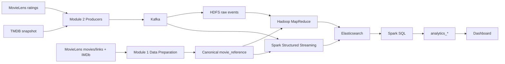

# Phân tích xu hướng tương tác với phim

Dự án sử dụng dữ liệu thật từ MovieLens, IMDb và TMDB để phân tích mức độ
quan tâm tới phim theo thời gian. Trong nhánh MovieLens, **một rating là
một interaction**, không phải một lượt xem.

Kiến trúc đích là Lambda Architecture trên Kubernetes, với môi trường dự
kiến một VM Ubuntu có 8 GB RAM. Batch dùng **HDFS + Hadoop MapReduce**;
Speed dùng **Spark Structured Streaming**; Serving dùng **Elasticsearch**;
Query dùng **Spark SQL**; Dashboard đọc kết quả `analytics_*`.

## Trạng thái hiện tại

Cập nhật ngày **08/10/2026**, dựa trên artifact và kiểm tra local:

| Hạng mục | Trạng thái |
| --- | --- |
| Module 01 — Data Source & Preparation | Hoàn thành phần local Bước 1–15: tải nguồn, profiling, reference, sorted ratings, adapters, schemas, fixtures và manifest. |
| Reference | 9.742 phim; `ref_version=20261004-5b4e04a2`; giữ đủ MovieLens movies qua LEFT JOIN. |
| Replay input | 100.836 ratings, giữ nguyên nội dung và sắp theo timestamp nguồn. |
| TMDB | Đã crawl thành công một snapshot 20 phim trending. |
| Contract/fixtures | Ba schema v1.0 và ba fixture thật, mỗi fixture 20 record; sample join `movieId -> genres` chạy được local. |
| Kiểm thử | 133 tests PASS; audit local PASS. Chi tiết và thời điểm chạy ở `data/reports/module_01_audit.json`. |
| Contract nền | [DATA_CONTRACT.md](DATA_CONTRACT.md) đã có, vẫn là `1.0-draft`; chưa ghi nhận xác nhận freeze của nhóm. |
| HDFS publish và handoff | Chờ HDFS endpoint/path và xác nhận consume của Module 2/4/5. |
| Module 2–9 | Chưa có implementation hoặc bằng chứng chạy end-to-end trong repository này. |

**Giới hạn dữ liệu cần biết:** snapshot TMDB hiện tại có **0/20 phim** ánh
xạ được vào reference MovieLens nhỏ. Nhánh TMDB giữ identity/timeline riêng
và phải giữ record chưa có mapping. Không INNER JOIN rồi loại mất snapshot.

## Bắt đầu từ đâu?

| Bạn cần làm gì? | Đọc/chạy |
| --- | --- |
| Hiểu interface toàn dự án | [DATA_CONTRACT.md](DATA_CONTRACT.md): schema, time semantics, paths, metric và ownership. |
| Chạy hoặc tiếp nhận Module 01 | [modules/data_source/README.md](modules/data_source/README.md): setup, pipeline, artifacts, API và handoff. |
| Dùng sample để phát triển consumer | [contracts/README.md](contracts/README.md): schema, cách đọc JSONL/TSV, validation và smoke join. |
| Xem kết quả đánh giá thiết kế | [REVIEW_MODULE_01.md](modules/data_source/REVIEW_MODULE_01.md). |

Nếu đã có `.venv`, dataset và snapshot local, chạy từ thư mục gốc:

```bash
make -C modules/data_source verify
```

Lệnh kiểm tra dữ liệu có sẵn và tạo lại fixtures/manifest/reports. Với máy
mới clone repository, làm theo mục setup và chuẩn bị dữ liệu của Module
01 trước; raw/prepared datasets và secret không được đưa vào Git.

## Kiến trúc và ranh giới trách nhiệm



Event dùng Kafka trước khi vào Batch/Speed. Reference đi theo đường chuẩn
bị/publish riêng; consumer dùng canonical reference thay vì tự join raw
IMDb/MovieLens. Module 01 cung cấp adapter và fetch-once; Module 02 sở hữu
replay timing, scheduler TMDB và KafkaProducer.

| Module | Input | Output/trách nhiệm | Owner đã ghi nhận |
| --- | --- | --- | --- |
| 1. Data Source & Preparation | MovieLens, IMDb, TMDB API | Prepared files, adapters, schemas, samples, manifest; sở hữu canonical reference. | Chưa ghi tên |
| 2. Kafka/Ingestion | Sorted ratings, source adapters | `movie-events`, `tmdb-snapshots`; replay và scheduler. | Chưa ghi tên |
| 3. HDFS | Kafka events, canonical reference | Raw storage, NameNode/DataNode, endpoint cho reference publish. | Giang |
| 4. Hadoop MapReduce | Raw ratings và reference | Batch movie/daily/genre aggregates, count và rating sum. | Đỗ Sơn |
| 5. Spark Streaming | Kafka và canonical reference | Realtime movie/genre windows; TMDB current signal riêng. | Thắng + Hiếu |
| 6. Elasticsearch | Batch/Realtime outputs | Mapping, batch loading và serving indices. | Chưa ghi tên |
| 7. Spark SQL | Batch/Realtime indices | Merge theo cutoff; trending/growth; `analytics_*`. | Chưa ghi tên |
| 8. Dashboard | `analytics_*` | Read-only visualization và insight. | Chưa ghi tên |
| 9. Integration & Testing | Tất cả interface | Smoke tests, end-to-end trace và kiểm tra tài nguyên. | Chưa ghi tên |

Tên owner được giữ từ tài liệu kickoff; đây không phải xác nhận đã bàn
giao. Module 1 cung cấp trực tiếp reference/sample cho cả Module 4 và 5,
bên cạnh Module 2 và 3.

## Các quy tắc mọi module phải giữ

- **ID và field:** dùng `movieId`, `tmdbId`, `imdbId`, `userId` đúng
  namespace; TMDB dùng `vote_count`, `vote_average`, `event_time`.
- **Thời gian:** business window dùng `event_time`; `ingest_time` dùng
  vận hành. MovieLens replay giữ thời gian lịch sử, TMDB dùng thời gian
  snapshot. Timestamp trao đổi là UTC, `YYYY-MM-DDTHH:MM:SSZ`.
- **Reference:** TSV có header, genres là string phân tách bằng pipe;
  missing mapping là null. Đường dẫn HDFS canonical dự kiến:
  `/movies/ref/current/movie_reference.tsv`.
- **Batch/Speed:** Batch tính `event_time < T`, Query dùng Realtime có
  `window_start >= T`; chọn một window size để tránh double count.
  Count/sum được giữ để tính weighted average.
- **Metrics:** một rating bằng một interaction. Query Layer tính
  `trending_score=(current-previous)/(previous+1)` và `growth_7d`;
  Dashboard hiển thị kết quả. Không gộp popularity TMDB với count MovieLens
  thành cùng metric/timeline.
- **Dữ liệu thật:** fixture được cắt từ nguồn thật. Raw bất biến, lỗi có
  lý do kiểm tra, retry giữ identity; không dùng output minh họa làm bằng
  chứng integration.

Tên topic, index, HDFS path và schemas đầy đủ được định nghĩa trong
[DATA_CONTRACT.md](DATA_CONTRACT.md). README này hướng dẫn vận hành và
trạng thái; không tạo một bản contract khác.

## Lộ trình tích hợp tiếp theo

1. Nhóm review/freeze draft contract và xác nhận owner mỗi output.
2. Module 2 consume fixture, reuse normalizers rồi kiểm tra payload Kafka.
3. Module 3 cung cấp HDFS; Module 1 publish reference theo version, verify
   checksum/row count trước khi cập nhật `current`.
4. Module 4/5 kiểm tra sample, rồi chạy MapReduce và Spark static join thật.
5. Module 6/7/8 hoàn thiện serving, truy vấn theo cutoff và dashboard.
6. Module 9 trace một event thật xuyên suốt, đối chiếu số liệu và đo RAM.

Hạ tầng dự kiến: Kafka KRaft một broker, HDFS một NameNode/hai DataNode,
Elasticsearch single node. Tài nguyên, phiên bản image/connector, watermark,
checkpoint và cơ chế publish cần được owner kiểm tra khi triển khai. Chưa
có benchmark tài nguyên hay Kubernetes manifests được xác nhận trong repo.

## Nguồn dữ liệu

- [GroupLens MovieLens](https://grouplens.org/datasets/movielens/)
- [IMDb Non-Commercial Datasets](https://developer.imdb.com/non-commercial-datasets/)
- [The Movie Database API](https://developer.themoviedb.org/docs/getting-started)

Attribution TMDB: “This product uses the TMDB API but is not endorsed or
certified by TMDB.”
