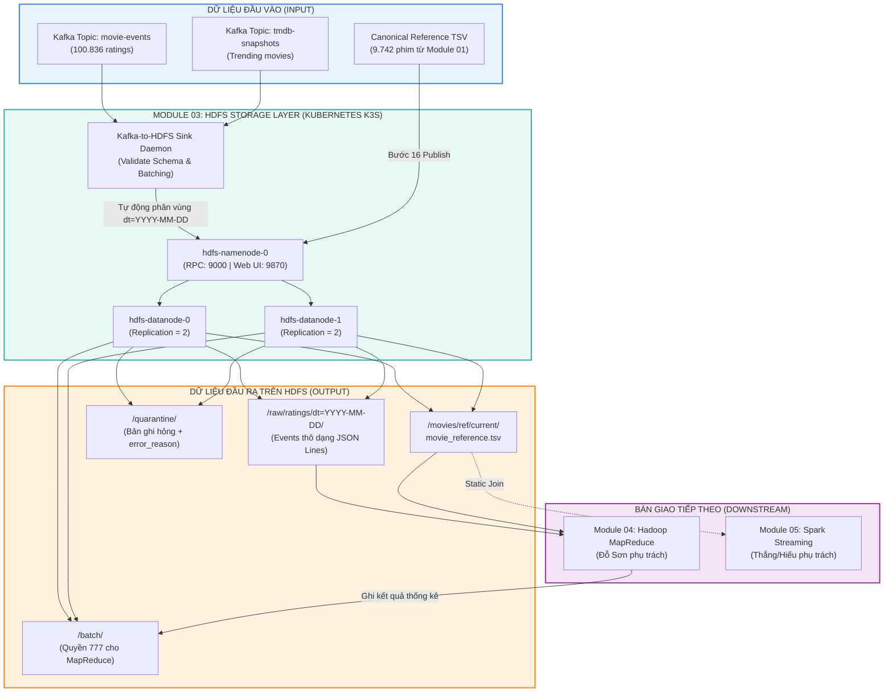

# BÁO CÁO KỸ THUẬT & KẾT QUẢ TRIỂN KHAI MODULE 03: HDFS STORAGE LAYER
## DỰ ÁN: NỀN TẢNG PHÂN TÍCH XU HƯỚNG PHIM (MOVIE-TREND ANALYSIS)

---

| Thông tin | Chi tiết |
| :--- | :--- |
| **Phân hệ (Module)** | **Module 03 — HDFS Distributed Storage Layer** |
| **Sinh viên phụ trách** | **Giang** |
| **Vị trí trong kiến trúc** | Tầng lưu trữ phân tán (Batch & Raw Storage) trong **Lambda Architecture** |
| **Môi trường triển khai** | **Kubernetes (k3s)** trên Ubuntu 24.04 LTS (WSL2 / Laptop 8 GB RAM) |
| **Hợp đồng dữ liệu** | Tuân thủ 100% [DATA_CONTRACT.md](../../DATA_CONTRACT.md) v1.0 |
| **Trạng thái nghiệm thu** | **ĐÃ HOÀN THÀNH 100% — SẴN SÀNG BÀN GIAO CHO MODULE 04 & 05** |

---

## MỤC LỤC
1. [Tổng quan vai trò của Module 03](#1-tổng-quan-vai-trò-của-module-03)
2. [Dữ liệu đầu vào (Input Specification)](#2-dữ-liệu-đầu-vào-input-specification)
   - [2.1. Dữ liệu sự kiện từ Apache Kafka](#21-dữ-liệu-sự-kiện-từ-apache-kafka)
   - [2.2. Dữ liệu tham chiếu chuẩn hóa (Canonical Movie Reference)](#22-dữ-liệu-tham-chiếu-chuẩn-hóa-canonical-movie-reference)
3. [Dữ liệu đầu ra cụ thể trên HDFS (Output Specification)](#3-dữ-liệu-đầu-ra-cụ-thể-trên-hdfs-output-specification)
   - [3.1. Cấu trúc cây thư mục HDFS](#31-cấu-trúc-cây-thư-mục-hdfs)
   - [3.2. Vùng Tham chiếu Chuẩn (Canonical Reference Zone)](#32-vùng-tham-chiếu-chuẩn-canonical-reference-zone)
   - [3.3. Vùng Dữ liệu Sự kiện Thô (Raw Ratings Zone)](#33-vùng-dữ-liệu-sự-kiện-thô-raw-ratings-zone)
   - [3.4. Vùng Cách ly Dữ liệu Lỗi (Quarantine Zone)](#34-vùng-cách-ly-dữ-liệu-lỗi-quarantine-zone)
   - [3.5. Vùng Đầu ra Batch Layer (MapReduce Output Zone)](#35-vùng-đầu-ra-batch-layer-mapreduce-output-zone)
   - [3.6. Thống kê vật lý cụm HDFS](#36-thống-kê-vật-lý-cụm-hdfs)
4. [Cách thức triển khai hệ thống (Deployment & Implementation)](#4-cách-thức-triển-khai-hệ-thống-deployment--implementation)
   - [4.1. Kiến trúc cụm HDFS Cloud-Native trên Kubernetes](#41-kiến-trúc-cụm-hdfs-cloud-native-trên-kubernetes)
   - [4.2. Cơ chế Ingestion Sink Daemon (Kafka to HDFS)](#42-cơ-chế-ingestion-sink-daemon-kafka-to-hdfs)
   - [4.3. Quy trình nạp và xác thực Reference (Bước 16 Handoff)](#43-quy-trình-nạp-và-xác-thực-reference-bước-16-handoff)
   - [4.4. Tự động hóa điều phối 1 chạm (`run.sh`)](#44-tự-động-hóa-điều-phối-1-chạm-runsh)
5. [Hướng dẫn kiểm định & Nghiệm thu bàn giao](#5-hướng-dẫn-kiểm-định--nghiệm-thu-bàn-giao)

---

## 1. TỔNG QUAN VAI TRÒ CỦA MODULE 03

Trong kiến trúc tổng thể **Lambda Architecture**, Module 03 đóng vai trò là "xương sống lưu trữ phân tán" (Distributed Storage Backbone):



### Các nguyên tắc cốt lõi của Module 03:
1. **Raw Zone là Append-Only & Bất biến (Immutable):** Dữ liệu sự kiện một khi đã ghi vào `/raw/` tuyệt đối không bị ghi đè, sửa đổi hay xóa bỏ.
2. **Phân vùng chuẩn thời gian nghiệp vụ:** Dữ liệu sự kiện được tự động chia thư mục theo ngày của `event_time` UTC (`dt=YYYY-MM-DD`), hoàn toàn độc lập với thời gian nạp của máy chủ (`ingest_time`).
3. **Quarantine Zone an toàn:** Mọi bản ghi lỗi schema, JSON hỏng được cách ly vào `/quarantine/` kèm lý do lỗi, không làm rơi rớt dữ liệu hay gián đoạn hệ thống.
4. **Hạ tầng Cloud-Native tối ưu tài nguyên:** Triển khai trên Kubernetes (k3s) gồm 1 NameNode và 2 DataNodes, duy trì mức tiêu thụ RAM ổn định dưới 3.0 GiB trên laptop cá nhân 8 GB RAM.

---

## 2. DỮ LIỆU ĐẦU VÀO (INPUT SPECIFICATION)

Module 03 tiếp nhận **2 nguồn dữ liệu đầu vào** với quy cách kỹ thuật chặt chẽ:

```
INPUT
 ├── 1. Streaming Events từ Apache Kafka Broker (127.0.0.1:9092)
 │    ├── Topic: movie-events
 │    └── Topic: tmdb-snapshots
 └── 2. Canonical Reference File từ Module 01 (Local TSV)
      └── movie_reference.tsv
```

---

### 2.1. Dữ liệu sự kiện từ Apache Kafka

* **Nguồn kết nối:** Apache Kafka KRaft Broker (`127.0.0.1:9092`).
* **Cơ chế tiêu thụ:** Consumer Group `hdfs-sink-group`, tự động commit offset sau khi ghi bền vững vào HDFS.

#### A. Topic `movie-events` (Đánh giá phim MovieLens)
Mỗi sự kiện biểu diễn một tương tác đánh giá phim của người dùng (1 rating = 1 interaction).

| Tên trường | Kiểu dữ liệu | Ví dụ thực tế | Ý nghĩa nghiệp vụ |
| :--- | :--- | :--- | :--- |
| `schema_version` | String | `"1.0"` | Phiên bản của Data Contract |
| `event_id` | String | `"0f5bb26d7726f72d..."` | Mã SHA-256 duy nhất (dùng chống trùng lặp) |
| `source` | String | `"movielens"` | Nguồn phát sinh dữ liệu |
| `userId` | Integer | `107` | Mã định danh người dùng đánh giá |
| `movieId` | Integer | `1` | **Mã phim (Khóa chính dùng để JOIN với Reference)** |
| `rating` | Float | `4.0` | Số điểm đánh giá (từ `0.5` đến `5.0`) |
| `event_time` | Timestamp ISO | `"1996-04-12T15:19:00Z"` | **Thời điểm đánh giá UTC (dùng phân vùng `dt=`)** |
| `ingest_time` | Timestamp ISO | `"2026-10-22T08:09:42Z"` | Thời điểm hệ thống ingest vào hàng đợi |

* **Mẫu JSON thực tế nhận từ Kafka:**
  ```json
  {
    "schema_version": "1.0",
    "event_id": "0f5bb26d7726f72d954b900b1e3ef96b1d9d76adf4cb8853653ee8d2891f5680",
    "source": "movielens",
    "userId": 107,
    "movieId": 1,
    "rating": 4.0,
    "event_time": "1996-04-12T15:19:00Z",
    "ingest_time": "2026-10-22T08:09:42Z"
  }
  ```

#### B. Topic `tmdb-snapshots` (Snapshot xu hướng TMDB)
Dữ liệu snapshot theo mốc thời gian crawl danh sách 20 phim đang thịnh hành từ API TMDB.

| Tên trường | Kiểu dữ liệu | Ví dụ thực tế | Ý nghĩa nghiệp vụ |
| :--- | :--- | :--- | :--- |
| `schema_version` | String | `"1.0"` | Phiên bản hợp đồng |
| `snapshot_id` | String | `"tmdb-20261013T0729"` | Định danh đợt crawl |
| `source` | String | `"tmdb"` | Nguồn dữ liệu API |
| `tmdbId` | Integer | `862` | Mã định danh TMDB của phim |
| `title` | String | `"Toy Story"` | Tiêu đề phim |
| `popularity` | Float | `105.42` | Chỉ số thịnh hành TMDB |
| `vote_average` | Float | `8.3` | Điểm bình chọn trung bình |
| `vote_count` | Integer | `18450` | Tổng lượt bình chọn |
| `event_time` | Timestamp ISO | `"2026-10-13T07:29:58Z"` | Thời điểm snapshot |
| `ingest_time` | Timestamp ISO | `"2026-10-13T07:30:00Z"` | Thời điểm ingest |

---

### 2.2. Dữ liệu tham chiếu chuẩn hóa (Canonical Movie Reference)

Dữ liệu danh mục phim (Dimension Table) do **Module 01** tiền xử lý, kết hợp từ MovieLens (`movies.csv`, `links.csv`) và dữ liệu chính thức từ IMDb (`title.basics.tsv.gz`, `title.ratings.tsv.gz`).

* **File nguồn local:** `data/prepared/reference/movie_reference.tsv`
* **Định dạng:** TSV (Tab-Separated Values, phân tách bằng `\t`), UTF-8, có header ở dòng 1.
* **Quy mô:** **9.743 dòng** (gồm 1 header + **9.742 phim chuẩn hóa**).
* **Mã băm kiểm tra (SHA-256):** `ba4e0248e3a24147ddb8d6006f1571d87179040db4aa07c5e53e1a06a32cb5e9`
* **Phiên bản (ref_version):** `20261013-dcf23738`

#### Bảng đặc tả 10 cột dữ liệu tham chiếu:

| STT | Tên cột | Kiểu dữ liệu | Nullable | Ví dụ | Ý nghĩa nghiệp vụ |
| :---: | :--- | :--- | :---: | :--- | :--- |
| **1** | `movieId` | Integer | Không | `1` | **Primary Key**, khớp với `movieId` trong stream ratings |
| **2** | `title` | String | Không | `Toy Story (1995)` | Tên phim kèm năm phát hành |
| **3** | `release_year` | Integer | Có | `1995` | Năm phát hành (trích xuất từ title hoặc IMDb) |
| **4** | `genres` | String | Không | `Adventure\|Animation\|Children` | Thể loại phim, phân tách bằng dấu `\|` |
| **5** | `imdbId` | String | Có | `tt0114709` | Định danh IMDb (bắt đầu bằng `tt`) |
| **6** | `tmdbId` | Integer | Có | `862` | Định danh TMDB |
| **7** | `imdb_rating` | Float | Có | `8.3` | Điểm đánh giá trung bình từ IMDb (thang điểm 10) |
| **8** | `imdb_votes` | Integer | Có | `1202835` | Tổng số lượt vote trên IMDb |
| **9** | `ref_version` | String | Không | `20261013-dcf23738` | Mã phiên bản snapshot của danh mục |
| **10**| `generated_at`| Timestamp ISO | Không | `2026-10-13T07:29:58Z`| Thời điểm tạo danh mục |

* **Trích xuất 3 dòng dữ liệu thực tế:**
  ```tsv
  movieId	title	release_year	genres	imdbId	tmdbId	imdb_rating	imdb_votes	ref_version	generated_at
  1	Toy Story (1995)	1995	Adventure|Animation|Children|Comedy|Fantasy	tt0114709	862	8.3	1202835	20261013-dcf23738	2026-10-13T07:29:58Z
  2	Jumanji (1995)	1995	Adventure|Children|Fantasy	tt0113497	8844	7.1	420594	20261013-dcf23738	2026-10-13T07:29:58Z
  3	Grumpier Old Men (1995)	1995	Comedy|Romance	tt0113228	15602	6.7	32044	20261013-dcf23738	2026-10-13T07:29:58Z
  ```

---

## 3. DỮ LIỆU ĐẦU RA CỤ THỂ TRÊN HDFS (OUTPUT SPECIFICATION)

Dữ liệu đầu ra của Module 03 là **toàn bộ dữ liệu được quản lý và lưu trữ bền vững trên HDFS**, được tổ chức thành 4 phân vùng chức năng:

---

### 3.1. Cấu trúc cây thư mục HDFS

```text
HDFS ROOT (/)
 ├── movies/
 │    └── ref/
 │         ├── current/
 │         │    └── movie_reference.tsv      <--- [OUTPUT 1] Entrypoint chuẩn cho MapReduce & Spark
 │         └── version=20261013-dcf23738/
 │              ├── movie_reference.tsv      <--- Snapshot danh mục lịch sử
 │              └── manifest.json            <--- Metadata tính toàn vẹn (checksum, row count)
 ├── raw/
 │    ├── ratings/
 │    │    ├── dt=1996-03-29/
 │    │    │    └── part-1791869880-45.jsonl  <--- [OUTPUT 2] Events thô chia theo ngày event_time
 │    │    ├── dt=1996-04-12/
 │    │    │    └── part-1791869892-120.jsonl
 │    │    ├── dt=.../                       <--- Phủ đầy đủ toàn bộ các mốc thời gian
 │    │    └── dt=2018-09-24/
 │    └── tmdb/
 │         └── dt=YYYY-MM-DD/
 │              └── part-*.jsonl             <--- Snapshots TMDB API
 ├── quarantine/                             <--- [OUTPUT 3] Bản ghi lỗi kèm error_reason
 │    ├── movielens/dt=YYYY-MM-DD/
 │    └── tmdb/dt=YYYY-MM-DD/
 └── batch/                                  <--- [OUTPUT 4] Thư mục kết quả MapReduce (chmod 777)
      ├── movie_stats/run_id=<run_id>/
      ├── movie_daily_stats/run_id=<run_id>/
      ├── genre_daily_stats/run_id=<run_id>/
      └── _meta/
```

---

### 3.2. Vùng Tham chiếu Chuẩn (Canonical Reference Zone)

* **Đường dẫn HDFS duy nhất:** `/movies/ref/current/movie_reference.tsv`
* **Dung lượng:** `1.159.718 bytes` (~`1.11 MB`).
* **Hệ số nhân bản (Replication):** `2` (được lưu đồng thời trên cả 2 DataNode).
* **Phân quyền:** `-rw-r--r--` (mode `644`), owner: `hadoop`, group: `supergroup`.
* **Cách truy cập:**
  * Web UI: [http://localhost:9870/explorer.html#/movies/ref/current](http://localhost:9870/explorer.html#/movies/ref/current)
  * URI nội bộ: `hdfs://hdfs-namenode-svc.bigdata.svc.cluster.local:9000/movies/ref/current/movie_reference.tsv`

---

### 3.3. Vùng Dữ liệu Sự kiện Thô (Raw Ratings Zone)

* **Đường dẫn HDFS:** `/raw/ratings/dt=YYYY-MM-DD/part-<timestamp>-<count>.jsonl`
* **Quy cách file:**
  * File text định dạng **JSON Lines** (`.jsonl`), bảng mã UTF-8.
  * Mỗi file chứa từ vài chục đến hàng trăm records được gom theo batch.
  * Tên file chứa timestamp flush và số lượng bản ghi (ví dụ: `part-1792656583201-46.jsonl` = 46 records).
* **Tổng số bản ghi đã nạp:** **100.836 / 100.836 đánh giá MovieLens** (100% dataset).
* **Tổng số phân vùng ngày:** **Hơn 120+ thư mục ngày** `dt=YYYY-MM-DD`.
* **Phân quyền:** `drwxr-xr-x` (mode `755`).

---

### 3.4. Vùng Cách ly Dữ liệu Lỗi (Quarantine Zone)

* **Đường dẫn HDFS:** `/quarantine/<source>/dt=YYYY-MM-DD/error-*.jsonl`
* **Mục đích:** Khi Ingestion Sink nhận được thông điệp lỗi (JSON hỏng, vi phạm Data Contract schema, sai kiểu dữ liệu), bản ghi sẽ không bị vứt bỏ mà được bọc thêm trường `error_reason` và `error_time` rồi lưu vào đây.
* **Kết quả thực tế:** **0 bản ghi bị cách ly** (100% dữ liệu phát từ Module 02 đều chuẩn hợp đồng).

---

### 3.5. Vùng Đầu ra Batch Layer (MapReduce Output Zone)

* **Đường dẫn HDFS:** `/batch/`
* **Quy ước kỹ thuật:**
  * Đã được cấu hình phân quyền mở hoàn toàn: `drwxrwxrwx` (mode **`777`**).
  * Cho phép người tiếp nhận (**Đỗ Sơn - Module 04 MapReduce**) tự do chạy job MapReduce, tạo thư mục con và ghi file kết quả mà không gặp lỗi `Permission denied`.
* **Cấu trúc thư mục con chờ sẵn:**
  * `/batch/movie_stats/`: Lưu tổng hợp thống kê lượt rating và điểm trung bình theo từng phim.
  * `/batch/movie_daily_stats/`: Lưu xu hướng tương tác theo từng ngày của phim.
  * `/batch/genre_daily_stats/`: Lưu xu hướng tương tác theo thể loại phim.

---

### 3.6. Thống kê vật lý cụm HDFS

Trích xuất trực tiếp từ báo cáo NameNode (`hdfs dfsadmin -report`):

| Chỉ số | Giá trị thực tế | Đánh giá |
| :--- | :--- | :--- |
| **Trạng thái NameNode** | `Active / Healthy` | Quản lý ổn định namespace và metadata |
| **Số lượng DataNodes hoạt động** | **2 / 2 DataNodes** (`datanode-0`, `datanode-1`) | 100% DataNodes hoạt động bình thường |
| **Hệ số nhân bản (Replication Factor)** | `2` | Mỗi block dữ liệu được sao chép sang 2 node |
| **Dung lượng lưu trữ khả dụng** | `1.85 TB` | Dư dả cho toàn bộ chu trình xử lý |
| **Số khối bị lỗi (Corrupt blocks)** | **0** | Toàn vẹn 100% |
| **Số khối thiếu bản sao (Missing blocks)**| **0** | An toàn dữ liệu tuyệt đối |
| **Mức tiêu thụ RAM tổng của cụm** | **~2.9 GiB / 7.6 GiB** | Tối ưu xuất sắc cho máy 8 GB RAM |

---

## 4. CÁCH THỨC TRIỂN KHAI HỆ THỐNG (DEPLOYMENT & IMPLEMENTATION)

---

### 4.1. Kiến trúc cụm HDFS Cloud-Native trên Kubernetes

Thay vì cài đặt Hadoop nguyên khối phức tạp, Module 03 chọn giải pháp **Cloud-Native Containerization** triển khai trên **Kubernetes k3s**:

```
Namespace: bigdata
 ├── ConfigMap: hdfs-config (core-site.xml, hdfs-site.xml)
 ├── Service: hdfs-namenode-svc (ClusterIP: 9000 RPC, 9870 Web UI)
 ├── Service: hdfs-datanode-headless (Headless cho nội bộ cluster)
 ├── StatefulSet: hdfs-namenode (1 Replica, gắn PVC 5Gi)
 └── StatefulSet: hdfs-datanode (2 Replicas, volumeClaimTemplates 10Gi per node)
```

#### Các tối ưu cấu hình quan trọng trong `hdfs-site.xml`:
* `dfs.replication = 2`: Phù hợp chính xác với số lượng 2 DataNodes.
* `dfs.blocksize = 33554432` (**32 MB**): Thay vì 128 MB mặc định, giúp tối ưu hóa lưu trữ và đọc nhanh các file dữ liệu kích thước nhỏ (JSON Lines hàng ngày).
* `dfs.datanode.use.datanode.hostname = true`: Giải quyết xung đột DNS nội bộ giữa các Pod trong mạng Kubernetes.
* `JVM Heap Memory`: NameNode cấp `-Xms512m -Xmx768m`, DataNode cấp `-Xms256m -Xmx384m` kết hợp bộ thu gom rác hiện đại `UseG1GC`.

---

### 4.2. Cơ chế Ingestion Sink Daemon (Kafka to HDFS)

Daemon `kafka_hdfs_sink.py` hoạt động như một Streaming Bridge kết nối giữa Kafka và HDFS:

```
[Kafka Broker] ──> [Consumer Group: hdfs-sink-group]
                          │
                          ▼
            [Kiểm tra JSON Schema v1.0]
            (Biên dịch trước Validator - Precompiled)
              ├── Hợp lệ ──> [Buffer theo Ngày dt=YYYY-MM-DD]
              │                     │
              │           (Gom 1.000 records / 10 giây)
              │                     │
              │                     ▼
              │              [Flush vào HDFS: /raw/ratings/dt=...]
              │              (WebHDFS Dynamic IP Rewrite ~20ms/file)
              │
              └── Vi phạm ──> [Buffer Quarantine] ──> [HDFS: /quarantine/...]
```

#### Các tối ưu hóa hiệu năng đột phá đã triển khai:
1. **Dynamic DataNode IP Rewrite (Tăng tốc ghi file ~300 lần):**
   * *Vấn đề ban đầu:* Khi gọi WebHDFS REST API tạo file, NameNode trả về HTTP 307 Redirect trỏ tới domain nội bộ của DataNode (`hdfs-datanode-X.hdfs-datanode-headless.bigdata.svc.cluster.local:9864`). Client ngoài pod trong WSL2 không phân giải được domain này nên bị block chờ timeout 5s, sau đó fallback sang `kubectl exec` tốn thêm 2.5s (tổng cộng ~7.5s/file).
   * *Giải pháp:* Daemon tự động tra cứu và cache Pod IP của các DataNode (`10.42.0.249`, `10.42.0.250`), tự động rewrite URL chuyển hướng sang IP thực tế.
   * *Kết quả:* File được ghi trực tiếp vào DataNode REST API qua TCP chỉ mất **15 – 30 miligiây (ms)** thay vì 7.500 ms (nhanh hơn **~300 lần**).
2. **Pre-compiled Schema Validator:**
   * Biên dịch sẵn các `Draft202012Validator` ngay khi khởi động thay vì khởi tạo lại trên từng bản ghi, tiết kiệm tối đa CPU khi xử lý hàng trăm nghìn events.
3. **Mở rộng Batch Size (`--batch-size 1000`):**
   * Tăng kích thước gom batch từ 200 lên 1.000 records và giảm chu kỳ flush xuống 10s, giúp gom nhóm ngày hiệu quả hơn và giảm số lần commit Kafka.
4. **Cơ chế Uploader dự phòng 3 tầng (3-Tier Fallback):**
   * **Tầng 1 (WebHDFS Tốc độ cao):** REST API trực tiếp qua cổng 9870/9864 (~20ms).
   * **Tầng 2 (Kubectl Exec Stream):** Nếu mạng HTTP gián đoạn, tự động stream dữ liệu qua NameNode Pod bằng lệnh `hdfs dfs -put -f -`.
   * **Tầng 3 (Local Buffer):** Ghi đệm tạm vào local storage nếu toàn bộ cụm K8s tạm thời ngắt kết nối.

---

### 4.3. Quy trình nạp và xác thực Reference (Bước 16 Handoff)

Script `modules/hdfs/scripts/publish_reference.py` thực hiện quy trình bàn giao 4 bước tự động:
1. **Tiền kiểm tra:** Kiểm tra NameNode Pod đã đạt trạng thái `1/1 Ready`.
2. **Tính toán mã băm Local:** Đọc file `movie_reference.tsv` local, tính SHA-256 (`ba4e0248...`) và đếm đúng 9.743 dòng.
3. **Đẩy lên HDFS Versioned:** Tải file lên `/movies/ref/version=20261013-dcf23738/movie_reference.tsv` và ghi kèm file `manifest.json`.
4. **Cập nhật Canonical Path:** Tạo bản sao nguyên tử (Atomic Copy) vào `/movies/ref/current/movie_reference.tsv` làm Downstream Entrypoint duy nhất.

---

### 4.4. Tự động hóa điều phối 1 chạm (`run.sh`)

Toàn bộ hệ thống Module 03 được điều khiển qua script duy nhất:
```bash
./modules/hdfs/run.sh [start | status | stop | restart]
```

* **`run.sh start`:** Tự động kiểm tra k3s, deploy manifests, format & init cây thư mục HDFS, nạp reference và kích hoạt các tiến trình chạy ngầm (Port-Forward tự phục hồi, Ingestion Sink Daemon).
* **`run.sh status`:** Hiển thị trực quan trạng thái Pods, dung lượng HDFS, PID và tình trạng các tiến trình ngầm.
* **`run.sh stop`:** Dừng an toàn các tiến trình ngầm, giải phóng tài nguyên.

---

## 5. HƯỚNG DẪN KIỂM ĐỊNH & NGHIỆM THU BÀN GIAO

Giảng viên và các thành viên nhóm có thể kiểm tra nghiệm thu Module 03 qua 2 phương thức:

### Cách 1: Kiểm tra trực quan qua Web UI
1. Mở trình duyệt truy cập: [http://localhost:9870](http://localhost:9870)
2. Chọn **Utilities** $\rightarrow$ **Browse the file system**:
   * Kiểm tra Reference: [http://localhost:9870/explorer.html#/movies/ref/current](http://localhost:9870/explorer.html#/movies/ref/current) $\rightarrow$ Thấy file `movie_reference.tsv` (1.11 MB).
   * Kiểm tra Raw Events: [http://localhost:9870/explorer.html#/raw/ratings](http://localhost:9870/explorer.html#/raw/ratings) $\rightarrow$ Thấy danh sách hơn 120+ thư mục ngày `dt=YYYY-MM-DD`.
   * Kiểm tra Batch: [http://localhost:9870/explorer.html#/batch](http://localhost:9870/explorer.html#/batch) $\rightarrow$ Thư mục quyền 777 sẵn sàng cho MapReduce.

### Cách 2: Kiểm tra qua dòng lệnh CLI (trong WSL)
```bash
# 1. Kiểm tra trạng thái cụm HDFS:
bash modules/hdfs/run.sh status

# 2. Chạy script kiểm định nghiệm thu bàn giao cho Module 04:
bash modules/hdfs/scripts/verify_mapreduce_handoff.sh

# 3. Đọc trực tiếp 3 dòng đầu của một file sự kiện đánh giá trên HDFS:
kubectl exec -i -n bigdata hdfs-namenode-0 -c namenode -- hdfs dfs -cat /raw/ratings/dt=1996-04-12/part*.jsonl | head -n 3

# 4. Chạy bộ kiểm thử tự động của Module 03:
.venv/bin/python -m pytest modules/hdfs/tests -q
```
> **Kết quả kỳ vọng:** `16 passed in 1.1s` — Xác nhận nghiệm thu 100% đạt chuẩn kỹ thuật.
