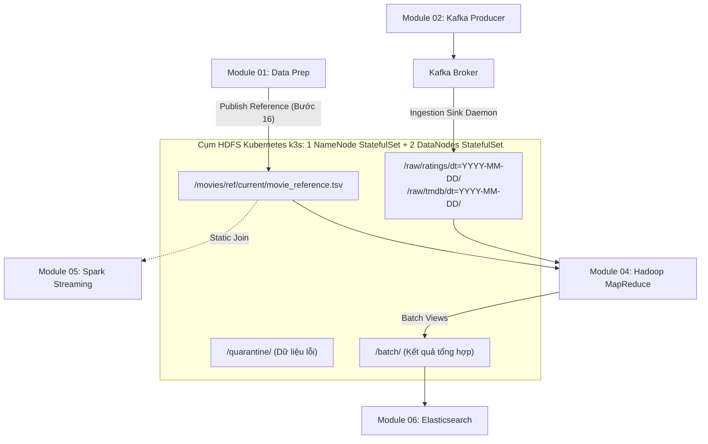

# Module 03: HDFS Storage Layer

Tầng lưu trữ phân tán (**Distributed Storage Layer**) cho dữ liệu thô (Raw Events), dữ liệu tham chiếu chuẩn hóa (Canonical Reference) và kết quả tổng hợp lô (Batch Views) trong kiến trúc **Lambda Architecture** của dự án phân tích xu hướng phim (Movie-Trend).

- **Phụ trách (Owner):** Giang  
- **Vị trí hệ thống:** `modules/hdfs`  
- **Môi trường mục tiêu:** 01 Ubuntu VM (8 GB RAM), triển khai trên **Kubernetes (k3s)** (Kiến trúc Cloud-Native).  
- **Hợp đồng dữ liệu:** Tuân thủ 100% [DATA_CONTRACT.md](../../DATA_CONTRACT.md) (v1.0-draft).
- **Tài liệu kiến trúc K8s:** [docs/K8S_MIGRATION_GUIDE.md](docs/K8S_MIGRATION_GUIDE.md).

---

## 1. Kiến trúc & Vai trò trong Lambda Architecture

Trong kiến trúc tổng thể, Module 03 là "xương sống lưu trữ" kết nối giữa Ingestion, Data Preparation và Batch Processing:



### Các nguyên tắc bất di bất dịch của HDFS:
1. **Raw Zone là Append-Only & Bất biến (Immutable):** Dữ liệu sự kiện một khi đã ghi vào `/raw/` sẽ không được sửa đổi, xóa bỏ hay ghi đè.
2. **Canonical Reference sở hữu bởi Module 01:** Module 03 quản lý hạ tầng và cung cấp endpoint; Module 01 sở hữu nội dung và thực hiện publish có kiểm tra mã băm SHA256 và số dòng (9.742 phim).
3. **Phân vùng chuẩn thời gian nghiệp vụ:** Dữ liệu sự kiện được phân vùng theo ngày của `event_time` UTC (`dt=YYYY-MM-DD`), không lấy theo thời gian ingest của hệ thống.
4. **Không làm rơi rớt dữ liệu (Quarantine Zone):** Mọi sự kiện lỗi định dạng, JSON hỏng hoặc thiếu trường bắt buộc đều được cô lập vào `/quarantine/` kèm lý do lỗi.

---

## 2. Cấu trúc thư mục Module 03

```text
modules/hdfs/
├── README.md                           # Tài liệu tổng quan Module 03
├── BAO_CAO_MODULE_03_HDFS.md           # Báo cáo kỹ thuật nghiệm thu toàn diện (Input, Output, Triển khai)
├── HANDOFF_MODULE_03.md                # Tài liệu đặc tả nghiệm thu & bàn giao các bên
├── TROUBLESHOOTING.md                  # Cẩm nang tra cứu và xử lý sự cố nhanh trên Kubernetes
├── run.sh                              # Script điều khiển 1 chạm (start, status, stop, restart)
├── Makefile                            # Các lệnh điều khiển tự động (make up, make pipeline,...)
├── config.yaml                         # Cấu hình tham số endpoints và đường dẫn Kubernetes
├── .env.example                        # Biến môi trường mẫu cho Kubernetes (port, namespace,...)
├── requirements.txt                    # Thư viện phụ thuộc Python (hdfs, kafka-python, pyyaml)
│
├── k8s/                                # Thư mục Manifests Kubernetes (k3s)
│   ├── 00-namespace.yaml               # Namespace bigdata
│   ├── 01-configmap.yaml               # core-site.xml, hdfs-site.xml
│   ├── 02-namenode.yaml                # NameNode StatefulSet + Services + PVC 5Gi + InitContainer
│   ├── 03-datanode.yaml                # DataNode StatefulSet (2 replicas) + volumeClaimTemplates 10Gi
│   └── kustomization.yaml              # Quản lý triển khai tập trung Kustomize
│
├── scripts/
│   ├── init_hdfs_dirs.sh               # Script tự động tạo cây thư mục và phân quyền HDFS Pod
│   ├── publish_reference.py            # Script thực hiện bàn giao Bước 16 với Module 01
│   ├── kafka_hdfs_sink.py              # Ingestion Daemon kéo dữ liệu từ Kafka vào HDFS tốc độ cao (~20ms)
│   └── verify_mapreduce_handoff.sh     # Script kiểm tra môi trường cho Module 04 MapReduce
│
└── docs/                               # Bộ tài liệu kỹ thuật chi tiết
    ├── K8S_MIGRATION_GUIDE.md          # TÀI LIỆU KIẾN TRÚC & TRIỂN KHAI KUBERNETES
    ├── HUONG_DAN_CHAY_MODULE_1_2_3.md  # CẨM NANG CHẠY LIÊN THÔNG TỪ ĐẦU ĐẾN CUỐI MODULE 01, 02, 03
    ├── 00_DANH_MUC_TAI_LIEU_MODULE_3.txt
    ├── 01_TONG_QUAN_VA_PHAN_TICH_YEU_CAU.txt
    ├── 02_HOP_DONG_DU_LIEU_VA_GIAO_TIEP_MODULE_3.txt
    ├── 03_THIET_KE_KIEN_TRUC_LUU_TRU_VA_TAI_NGUYEN.txt
    ├── 04_KE_HOACH_THUC_HIEN_VA_CHECKLIST_TIEN_DO.txt
    ├── 05_HUONG_DAN_CAI_DAT_K8S.txt
    ├── 06_GIAI_PHAP_KAFKA_TO_HDFS_SINK.txt
    ├── 07_SCRIPTS_VA_KICH_BAN_BAN_GIAO_HANDOFF.txt
    ├── 08_KICH_BAN_KIEM_THU_ACCEPTANCE_TEST.txt
    ├── 09_VAN_HANH_BAO_TRI_VA_XU_LY_SU_CO.txt
    └── 10_THONG_BAO_VA_MAU_BAO_CAO_HANDOFF.txt
```

---

## 3. Quy chuẩn đường dẫn HDFS (HDFS Path Contract)

| Phân vùng | Đường dẫn HDFS | Định dạng | Mô tả & Bên sử dụng |
| :--- | :--- | :--- | :--- |
| **Raw Ratings** | `/raw/ratings/dt=YYYY-MM-DD/part-*.jsonl` | JSONL UTF-8 | Lưu ratings MovieLens phân vùng theo `event_time`. Input cho MapReduce. |
| **Raw TMDB** | `/raw/tmdb/dt=YYYY-MM-DD/part-*.jsonl` | JSONL UTF-8 | Lưu snapshot TMDB trending (20 phim/lần crawl). |
| **Quarantine** | `/quarantine/<source>/dt=YYYY-MM-DD/error-*.jsonl` | JSONL UTF-8 | Lưu bản ghi lỗi schema kèm trường `error_reason`. |
| **Ref Version** | `/movies/ref/version=<ref_version>/movie_reference.tsv` | TSV UTF-8 | Lưu trữ phiên bản tham chiếu chuẩn lịch sử kèm `manifest.json`. |
| **Ref Current** | `/movies/ref/current/movie_reference.tsv` | TSV UTF-8 | **Downstream Entrypoint duy nhất** cho Module 04 (MapReduce) và Module 05 (Spark). |
| **Batch Stats** | `/batch/movie_stats/run_id=<run_id>/` | Text/Part | Kết quả tổng hợp phim từ MapReduce Job 1 & 2. |
| **Batch Daily** | `/batch/movie_daily_stats/run_id=<run_id>/` | Text/Part | Kết quả tổng hợp phim theo ngày từ MapReduce. |
| **Batch Genre** | `/batch/genre_daily_stats/run_id=<run_id>/` | Text/Part | Kết quả tổng hợp thể loại theo ngày từ MapReduce. |
| **Batch Meta** | `/batch/_meta/run_id=<run_id>/manifest.json` | JSON | Metadata xác nhận tính toàn vẹn mỗi lượt chạy batch. |

---

## 4. Tối ưu hóa bộ nhớ RAM trên máy ảo 8 GB

Toàn bộ hệ thống chạy chung trên 01 VM Ubuntu 8 GB RAM. Để đảm bảo Linux OOM Killer không tắt bất kỳ tiến trình nào, Module 03 áp dụng cấu hình tài nguyên nghiêm ngặt:

- **HDFS NameNode (Pod `hdfs-namenode-0`):** JVM Heap `-Xms512m -Xmx768m` (K8s Memory Limit: 1024Mi).
- **HDFS DataNodes (Pods `hdfs-datanode-0`, `hdfs-datanode-1`):** Mỗi Pod JVM Heap `-Xms128m -Xmx256m` (K8s Memory Limit: 512Mi), đảm bảo ~256Mi đệm cho bộ nhớ hệ thống/Metaspace, loại bỏ triệt để lỗi Pod bị OOMKilled khi chạy MapReduce.
- **HDFS Block Size:** `32 MB` (thay vì 128 MB mặc định) giúp chia block nhanh và tiết kiệm bộ nhớ quản lý của NameNode.
- **Replication Factor:** `2` (đảm bảo tính dự phòng trên 2 DataNodes mà không gây áp lực ổ đĩa).
- **Tổng RAM tiêu thụ của cả cụm HDFS:** $\le 1.4\text{ GB RAM}$, dành lại hơn 6.6 GB RAM cho Kafka, Spark, Elasticsearch và OS.

> [!IMPORTANT]
> **Lưu ý dữ liệu thô `/raw` & Quy tắc vận hành:**  
> - **Deduplication:** Trong `/raw/ratings` có 1.000 dòng trùng `event_id` do Sink từng vượt `max.poll.interval.ms` và re-poll lại một lô sự kiện. Module 04 (MapReduce - Đỗ Sơn) đã xử lý loại trùng nên kết quả Batch vẫn chính xác 100%.
> - **Quy tắc bắt buộc:** **TUYỆT ĐỐI KHÔNG CHẠY LẠI PRODUCER KHI `/raw` ĐÃ CÓ DỮ LIỆU** để tránh append thêm các bản ghi trùng vào các phân vùng ngày.

---

## 5. Hướng dẫn vận hành nhanh (Quickstart với Makefile)

Toàn bộ các lệnh dưới đây có thể chạy trực tiếp từ thư mục gốc của repository hoặc trong thư mục `modules/hdfs`:

```bash
# Xem danh sách tất cả các lệnh hỗ trợ:
make -C modules/hdfs help
```

### 5.1. Quy trình một chạm (One-click Pipeline — Khuyến nghị)
Đây là cách nhanh nhất và tiện lợi nhất cho người chạy cuối cùng:

```bash
# Bước 1: Khởi tạo môi trường ảo và file cấu hình cá nhân .env (nếu chạy lần đầu)
make -C modules/hdfs setup env

# Bước 2: Chạy toàn bộ pipeline Kubernetes
# (Triển khai K8s -> Chờ NameNode Ready -> Khởi tạo cây thư mục -> Publish Reference -> Verify MapReduce)
make -C modules/hdfs pipeline

# Bước 3: Kiểm tra sức khỏe toàn diện cụm và chạy 8 test cases tự động
make -C modules/hdfs verify
```

---

### 5.2. Các thao tác chi tiết trên Kubernetes k3s

```bash
# 1. Triển khai cụm HDFS lên Kubernetes (namespace: bigdata)
make -C modules/hdfs up

# 2. Xem trạng thái Pods, Services, PVCs và báo cáo dung lượng
make -C modules/hdfs status
make -C modules/hdfs report

# 3. Khởi tạo cấu trúc thư mục chuẩn (/raw, /quarantine, /movies, /batch)
make -C modules/hdfs init

# 4. Nghiệm thu bàn giao Bước 16 (Publish Canonical Reference lên K8s)
make -C modules/hdfs publish-ref

# 5. Kiểm tra môi trường cho Module 04 MapReduce
make -C modules/hdfs verify-mr

# 6. Forward port để xem Web UI tại http://localhost:9870
make -C modules/hdfs forward

# 7. Đo lường RAM/CPU tiêu thụ thực tế của cụm HDFS
make -C modules/hdfs stats

# 8. Khởi chạy Ingestion Daemon lắng nghe Kafka đẩy vào HDFS
make -C modules/hdfs sink

# 9. Chạy bộ kiểm thử tự động (16 test cases Module 01-03 và Kafka-HDFS Sink)
make -C modules/hdfs test
make -C modules/hdfs test-sink

# 10. Dừng cụm khi không sử dụng
make -C modules/hdfs down
```

---

## 6. Endpoints công bố toàn nhóm (Kubernetes Native)

- **NameNode RPC nội bộ cụm (DefaultFS cho MapReduce/Spark):**  
  `hdfs://hdfs-namenode-svc.bigdata.svc.cluster.local:9000`
- **WebHDFS REST API nội bộ cụm:**  
  `http://hdfs-namenode-svc.bigdata.svc.cluster.local:9870/webhdfs/v1`
- **Truy cập từ Host (qua Port-Forward `make forward`):**
  - NameNode RPC: `hdfs://localhost:9000`
  - NameNode Web UI: `http://localhost:9870`

---

## 7. Tài liệu tham khảo chi tiết

Mọi câu hỏi chuyên sâu về kiến trúc, hợp đồng dữ liệu và quy trình bảo trì, vui lòng xem các file tương ứng trong thư mục [docs/](docs/):
- **TÀI LIỆU KIẾN TRÚC KUBERNETES:** [docs/K8S_MIGRATION_GUIDE.md](docs/K8S_MIGRATION_GUIDE.md) *(Đọc tài liệu này đầu tiên)*
- Xem [docs/01_TONG_QUAN_VA_PHAN_TICH_YEU_CAU.txt](docs/01_TONG_QUAN_VA_PHAN_TICH_YEU_CAU.txt) để nắm phạm vi trách nhiệm.
- Xem [docs/06_GIAI_PHAP_KAFKA_TO_HDFS_SINK.txt](docs/06_GIAI_PHAP_KAFKA_TO_HDFS_SINK.txt) để xem kiến trúc Sink Daemon.
- Xem [docs/08_KICH_BAN_KIEM_THU_ACCEPTANCE_TEST.txt](docs/08_KICH_BAN_KIEM_THU_ACCEPTANCE_TEST.txt) để thực thi 7 kịch bản kiểm thử mẫu.
- Xem [docs/09_VAN_HANH_BAO_TRI_VA_XU_LY_SU_CO.txt](docs/09_VAN_HANH_BAO_TRI_VA_XU_LY_SU_CO.txt) để xử lý các mã lỗi HDFS.
- Xem [TROUBLESHOOTING.md](TROUBLESHOOTING.md) để tra cứu nhanh sự cố Pods, SafeMode, PVCs.
