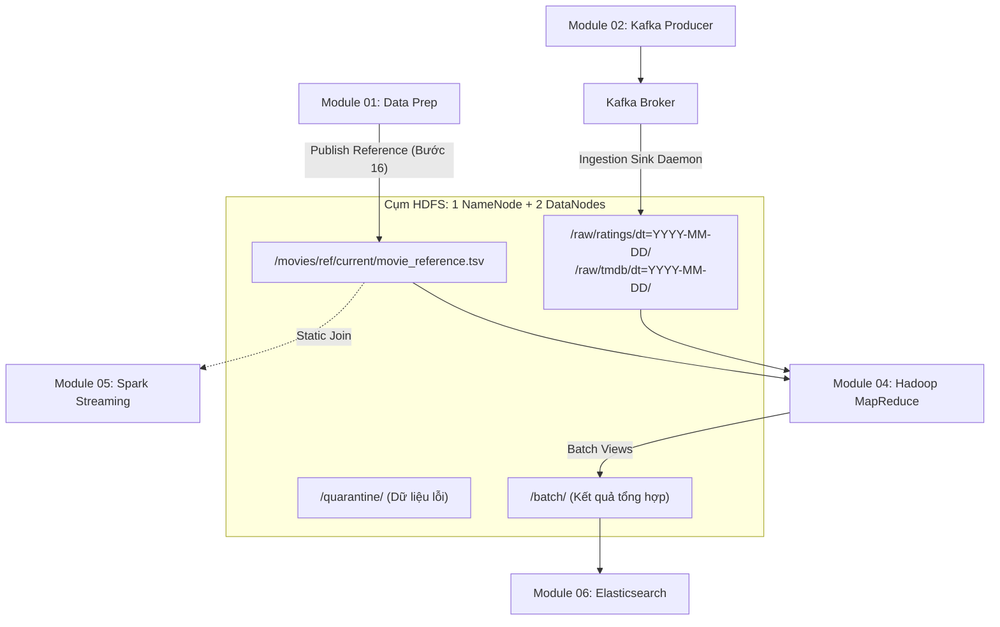

# Module 03: HDFS Storage Layer

Tầng lưu trữ phân tán (**Distributed Storage Layer**) cho dữ liệu thô (Raw Events), dữ liệu tham chiếu chuẩn hóa (Canonical Reference) và kết quả tổng hợp lô (Batch Views) trong kiến trúc **Lambda Architecture** của dự án phân tích xu hướng phim (Movie-Trend).

- **Phụ trách (Owner):** Giang  
- **Vị trí hệ thống:** `modules/hdfs`  
- **Môi trường mục tiêu:** 01 Ubuntu VM (8 GB RAM), triển khai bằng **Docker Compose** hoặc **Kubernetes (k3s)**.  
- **Hợp đồng dữ liệu:** Tuân thủ 100% [DATA_CONTRACT.md](../../DATA_CONTRACT.md) (v1.0-draft).

---

## 1. Kiến trúc & Vai trò trong Lambda Architecture

Trong kiến trúc tổng thể, Module 03 là "xương sống lưu trữ" kết nối giữa Ingestion, Data Preparation và Batch Processing:



### Các nguyên tắc bất di bất dịch của HDFS:
1. **Raw Zone là Append-Only & Bất biến (Immutable):** Dữ liệu sự kiện một khi đã ghi vào `/raw/` sẽ không được sửa đổi, xóa bỏ hay ghi đè.
2. **Canonical Reference sở hữu bởi Module 01:** Module 03 quản lý hạ tầng và cung cấp endpoint; Module 01 sở hữu nội dung và thực hiện publish có kiểm tra mã băm SHA256 và số dòng (9.742 phim).
3. **Phân vùng chuẩn thời gian nghiệp vụ:** Dữ liệu sự kiện được phân vùng theo ngày của `event_time` UTC (`dt=YYYY-MM-DD`), không lấy theo thời gian ingest của hệ thống.
4. **Không làm rơi rớt dữ liệu (Quarantine Zone):** Mọi sự kiện lỗi định dạng, JSON hỏng hoặc thiếu trường bắt buộc đều được cô lập vào `/quarantine/` kèm lý do lỗi.

---

## 2. Cấu trúc thư mục Module 03

```text
modules/hdfs/
├── README.md                           # Tài liệu tổng quan Module 03
├── HANDOFF_MODULE_03.md                # Tài liệu đặc tả nghiệm thu & bàn giao các bên
├── TROUBLESHOOTING.md                  # Cẩm nang tra cứu và xử lý sự cố nhanh
├── Makefile                            # Các lệnh điều khiển tự động (make up, make init,...)
├── config.yaml                         # Cấu hình tham số endpoints và đường dẫn
├── requirements.txt                    # Thư viện phụ thuộc Python (hdfs, kafka-python)
│
├── docker/
│   └── docker-compose.yml              # File triển khai cụm 1 NameNode + 2 DataNodes tối ưu 8GB RAM
│
├── scripts/
│   ├── init_hdfs_dirs.sh               # Script tự động tạo cây thư mục và phân quyền HDFS
│   ├── publish_reference.py            # Script thực hiện bàn giao Bước 16 với Module 01
│   ├── kafka_hdfs_sink.py              # Ingestion Daemon kéo dữ liệu từ Kafka vào HDFS
│   └── verify_mapreduce_handoff.sh     # Script kiểm tra môi trường cho Module 04 MapReduce
│
└── docs/                               # Bộ tài liệu kỹ thuật chi tiết (.txt)
    ├── 00_DANH_MUC_TAI_LIEU_MODULE_3.txt
    ├── 01_TONG_QUAN_VA_PHAN_TICH_YEU_CAU.txt
    ├── 02_HOP_DONG_DU_LIEU_VA_GIAO_TIEP_MODULE_3.txt
    ├── 03_THIET_KE_KIEN_TRUC_LUU_TRU_VA_TAI_NGUYEN.txt
    ├── 04_KE_HOACH_THUC_HIEN_VA_CHECKLIST_TIEN_DO.txt
    ├── 05_HUONG_DAN_CAI_DAT_DOCKER_VA_K8S.txt
    ├── 06_GIAI_PHAP_KAFKA_TO_HDFS_SINK.txt
    ├── 07_SCRIPTS_VA_KICH_BAN_BAN_GIAO_HANDOFF.txt
    ├── 08_KICH_BAN_KIEM_THU_ACCEPTANCE_TEST.txt
    ├── 09_VAN_HANH_BAO_TRI_VA_XU_LY_SU_CO.txt
    └── 10_THONG_BAO_VA_MAU_BAO_CAO_HANDOFF.txt
```

---

## 3. Quy chuẩn đường dẫn HDFS (HDFS Path Contract)

| Phân vùng | Đường dẫn HDFS | Định dạng | Mô tả & Bên sử dụng |
| :--- | :--- | :--- | :--- |
| **Raw Ratings** | `/raw/ratings/dt=YYYY-MM-DD/part-*.jsonl` | JSONL UTF-8 | Lưu ratings MovieLens phân vùng theo `event_time`. Input cho MapReduce. |
| **Raw TMDB** | `/raw/tmdb/dt=YYYY-MM-DD/part-*.jsonl` | JSONL UTF-8 | Lưu snapshot TMDB trending (20 phim/lần crawl). |
| **Quarantine** | `/quarantine/<source>/dt=YYYY-MM-DD/error-*.jsonl` | JSONL UTF-8 | Lưu bản ghi lỗi schema kèm trường `error_reason`. |
| **Ref Version** | `/movies/ref/version=<ref_version>/movie_reference.tsv` | TSV UTF-8 | Lưu trữ phiên bản tham chiếu chuẩn lịch sử kèm `manifest.json`. |
| **Ref Current** | `/movies/ref/current/movie_reference.tsv` | TSV UTF-8 | **Downstream Entrypoint duy nhất** cho Module 04 (MapReduce) và Module 05 (Spark). |
| **Batch Stats** | `/batch/movie_stats/run_id=<run_id>/` | Text/Part | Kết quả tổng hợp phim từ MapReduce Job 1 & 2. |
| **Batch Daily** | `/batch/movie_daily_stats/run_id=<run_id>/` | Text/Part | Kết quả tổng hợp phim theo ngày từ MapReduce. |
| **Batch Genre** | `/batch/genre_daily_stats/run_id=<run_id>/` | Text/Part | Kết quả tổng hợp thể loại theo ngày từ MapReduce. |
| **Batch Meta** | `/batch/_meta/run_id=<run_id>/manifest.json` | JSON | Metadata xác nhận tính toàn vẹn mỗi lượt chạy batch. |

---

## 4. Tối ưu hóa bộ nhớ RAM trên máy ảo 8 GB

Toàn bộ hệ thống chạy chung trên 01 VM Ubuntu 8 GB RAM. Để đảm bảo Linux OOM Killer không tắt bất kỳ tiến trình nào, Module 03 áp dụng cấu hình tài nguyên nghiêm ngặt:

- **HDFS NameNode:** JVM Heap `-Xms512m -Xmx768m` (Tối đa 1.0 GB container RAM).
- **HDFS DataNode 1 & 2:** Mỗi container JVM Heap `-Xms256m -Xmx384m` (Tối đa 512 MB container RAM).
- **HDFS Block Size:** `32 MB` (thay vì 128 MB mặc định) giúp chia block nhanh và tiết kiệm bộ nhớ quản lý của NameNode.
- **Replication Factor:** `2` (đảm bảo tính dự phòng trên 2 DataNodes mà không gây áp lực ổ đĩa).
- **Tổng RAM tiêu thụ của cả cụm HDFS:** $\le 1.5\text{ GB RAM}$, dành lại hơn 6.5 GB RAM cho Kafka, Spark, Elasticsearch và OS.

---

## 5. Hướng dẫn vận hành nhanh (Quickstart với Makefile)

Di chuyển vào thư mục `modules/hdfs`:

```bash
cd modules/hdfs
```

### 1. Khởi động cụm HDFS
```bash
make up
```
*Khởi chạy 1 NameNode và 2 DataNodes. Kiểm tra Web UI tại [http://localhost:9870](http://localhost:9870).*

### 2. Khởi tạo cấu trúc thư mục chuẩn
```bash
make init
```
*Tự động tạo các thư mục `/raw`, `/quarantine`, `/movies/ref`, `/batch` và phân quyền 777.*

### 3. Nghiệm thu bàn giao Bước 16 (Publish Canonical Reference)
```bash
make publish-ref
```
*Tải `movie_reference.tsv`, đối chiếu số dòng (9.743 dòng), kiểm tra mã băm SHA256 và cập nhật `/movies/ref/current/`.*

### 4. Kiểm tra sẵn sàng cho Module 04 MapReduce
```bash
make verify-mr
```

### 5. Chạy Ingestion Sink kéo dữ liệu từ Kafka xuống HDFS
```bash
make run-sink
```

### 6. Kiểm tra báo cáo cụm và đo RAM
```bash
make report
make stats
```

### 7. Dừng cụm HDFS
```bash
make down
```

---

## 6. Endpoints công bố toàn nhóm

- **NameNode RPC:** `hdfs://localhost:9000` (hoặc `hdfs://namenode:9000` trong Docker network `bigdata-net`)
- **WebHDFS REST API:** `http://localhost:9870/webhdfs/v1`
- **NameNode Web UI:** `http://localhost:9870`
- **DataNode 1 Web UI:** `http://localhost:9864`
- **DataNode 2 Web UI:** `http://localhost:9865`

---

## 7. Tài liệu tham khảo chi tiết

Mọi câu hỏi chuyên sâu về kiến trúc, hợp đồng dữ liệu và quy trình bảo trì, vui lòng xem các file tương ứng trong thư mục [docs/](docs/):
- Xem [docs/01_TONG_QUAN_VA_PHAN_TICH_YEU_CAU.txt](docs/01_TONG_QUAN_VA_PHAN_TICH_YEU_CAU.txt) để nắm phạm vi trách nhiệm.
- Xem [docs/06_GIAI_PHAP_KAFKA_TO_HDFS_SINK.txt](docs/06_GIAI_PHAP_KAFKA_TO_HDFS_SINK.txt) để xem kiến trúc Sink Daemon.
- Xem [docs/08_KICH_BAN_KIEM_THU_ACCEPTANCE_TEST.txt](docs/08_KICH_BAN_KIEM_THU_ACCEPTANCE_TEST.txt) để thực thi 7 kịch bản kiểm thử mẫu.
- Xem [docs/09_VAN_HANH_BAO_TRI_VA_XU_LY_SU_CO.txt](docs/09_VAN_HANH_BAO_TRI_VA_XU_LY_SU_CO.txt) để xử lý các mã lỗi HDFS.
