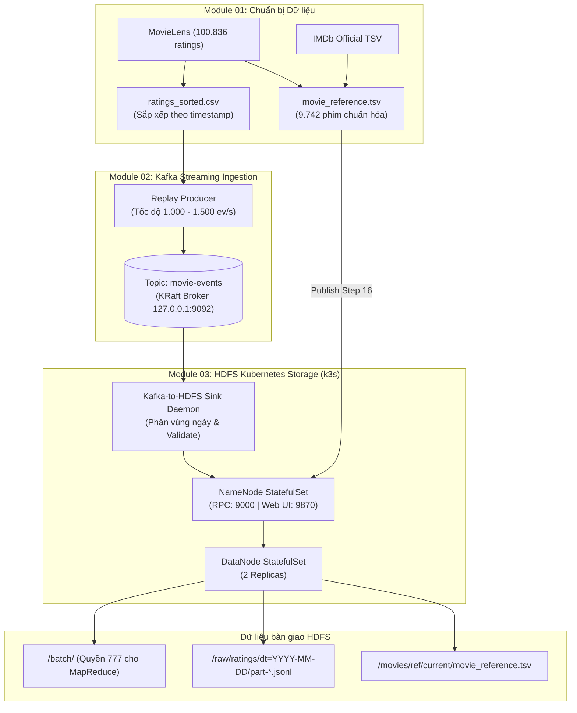

# HƯỚNG DẪN VẬN HÀNH TOÀN DIỆN TỪ ĐẦU ĐẾN CUỐI
## PIPELINE XỬ LÝ DỮ LIỆU LỚN: MODULE 01 $\rightarrow$ MODULE 02 $\rightarrow$ MODULE 03

> **Dự án:** Phân tích xu hướng tương tác phim (Movie-Trend Analysis Platform)  
> **Kiến trúc:** Lambda Architecture trên nền tảng Cloud-Native Kubernetes (k3s) & Apache Kafka (KRaft)  
> **Môi trường khuyến nghị:** Ubuntu 24.04 LTS trên WSL2 (Laptop / VM 8 GB RAM)  
> **Tuân thủ:** 100% [DATA_CONTRACT.md](../../../DATA_CONTRACT.md) v1.0  

---

## MỤC LỤC
1. [Tổng quan kiến trúc & Dòng chảy dữ liệu](#1-tổng-quan-kiến-trúc--dòng-chảy-dữ-liệu)
2. [Yêu cầu môi trường & Chuẩn bị ban đầu](#2-yêu-cầu-môi-trường--chuẩn-bị-ban-đầu)
3. [CÁCH 1: KHỞI CHẠY NHANH 1 CHẠM (QUICK START)](#3-cách-1-khởi-chạy-nhanh-1-chạm-quick-start)
4. [CÁCH 2: CHẠY CHI TIẾT TỪNG BƯỚC (STEP-BY-STEP)](#4-cách-2-chạy-chi-tiết-từng-bước-step-by-step)
   - [Bước 1: Module 01 — Chuẩn bị dữ liệu nguồn (Data Preparation)](#bước-1-module-01--chuẩn-bị-dữ-liệu-nguồn-data-preparation)
   - [Bước 2: Module 02 — Streaming Ingestion (Apache Kafka KRaft)](#bước-2-module-02--streaming-ingestion-apache-kafka-kraft)
   - [Bước 3: Module 03 — Tầng lưu trữ phân tán HDFS (Kubernetes)](#bước-3-module-03--tầng-lưu-trữ-phân-tán-hdfs-kubernetes)
   - [Bước 4: Bơm dữ liệu thật & Vận hành Ingestion Sink](#bước-4-bơm-dữ-liệu-thật--vận-hành-ingestion-sink)
5. [Kiểm tra dữ liệu đầu ra và nghiệm thu](#5-kiểm-tra-dữ-liệu-đầu-ra-và-nghiệm-thu)
6. [Chạy bộ kiểm thử tự động (Unit & Integration Tests)](#6-chạy-bộ-kiểm-thử-tự-động-unit--integration-tests)
7. [Dừng hệ thống & Xử lý sự cố thường gặp (Troubleshooting)](#7-dừng-hệ-thống--xử-lý-sự-cố-thường-gặp-troubleshooting)

---

## 1. TỔNG QUAN KIẾN TRÚC & DÒNG CHẢY DỮ LIỆU



---

## 2. YÊU CẦU MÔI TRƯỜNG & CHUẨN BỊ BAN ĐẦU

### 2.1. Yêu cầu hệ thống
* **Hệ điều hành:** Windows 10/11 có **WSL2** chạy **Ubuntu 24.04 LTS**.
* **Phần cứng:** Tối thiểu 8 GB RAM vật lý (WSL2 cấp phát ~4-6 GB RAM).
* **Công cụ cài sẵn trên WSL2:** `python3`, `python3-venv`, `curl`, `git`, `openjdk-17-headless`.

### 2.2. Vị trí mã nguồn khuyến nghị
> **QUAN TRỌNG:** Để đảm bảo quyền ghi POSIX, tốc độ I/O và tính tương thích của Kubernetes/Kafka, hãy sao chép repository vào thư mục Linux của WSL (ví dụ: `~/movie-trend` hoặc `/home/$USER/movie-trend`), không chạy trực tiếp trong `/mnt/c/` hay `/mnt/d/`.

```bash
# 1. Chuyển vào WSL Ubuntu:
wsl

# 2. Điều hướng vào thư mục mã nguồn:
cd ~/movie-trend

# 3. Tạo môi trường Python Virtual Environment dùng chung:
python3 -m venv .venv
source .venv/bin/activate

# 4. Cài đặt toàn bộ thư viện phụ thuộc:
pip install -r modules/data_source/requirements.txt
pip install -r modules/kafka_ingestion/requirements.txt
pip install -r modules/hdfs/requirements.txt
```

---

## 3. CÁCH 1: KHỞI CHẠY NHANH 1 CHẠM (QUICK START)

Nếu môi trường đã có sẵn dữ liệu và công cụ, bạn có thể khởi chạy toàn bộ hạ tầng chỉ với 3 lệnh:

```bash
# Bước 1: Khởi động Apache Kafka KRaft Broker
make -C modules/kafka_ingestion kafka-start

# Bước 2: Khởi chạy cụm HDFS (k3s), nạp danh mục phim chuẩn và bật Ingestion Sink Daemon
bash modules/hdfs/run.sh

# Bước 3: Bơm toàn bộ 100.836 đánh giá MovieLens vào hệ thống
make -C modules/kafka_ingestion producer RATE=1500 BATCH_SIZE=500 LIMIT=0
```

* **Kiểm tra trạng thái hệ thống:** `bash modules/hdfs/run.sh status`
* **Mở Web UI HDFS trên trình duyệt:** [http://localhost:9870](http://localhost:9870)

---

## 4. CÁCH 2: CHẠY CHI TIẾT TỪNG BƯỚC (STEP-BY-STEP)

Dành cho việc kiểm tra độc lập từng module, chấm điểm đồ án hoặc tái lập từ máy mới tinh.

---

### BƯỚC 1: MODULE 01 — CHUẨN BỊ DỮ LIỆU NGUỒN (DATA PREPARATION)

Module 01 chịu trách nhiệm tải dữ liệu thô MovieLens, IMDb, chuẩn hóa danh mục phim (`movie_reference.tsv`) và sắp xếp sự kiện đánh giá theo thời gian.

#### 1.1. Cấu hình file môi trường
```bash
cd ~/movie-trend
cp modules/data_source/.env.example modules/data_source/.env
```

#### 1.2. Tải dữ liệu nguồn (hoặc tái sử dụng dữ liệu có sẵn trong `data/raw/`)
> [!NOTE]
> Các script tải của Module 01 tuân thủ nguyên tắc **bất biến (immutability)** — nếu dữ liệu thô đã tồn tại trong `data/raw/`, script sẽ **từ chối ghi đè** để tránh tải lại hoặc làm hỏng dữ liệu gốc.
> Vì vậy, hãy dùng lệnh an toàn dưới đây (sẽ tự động bỏ qua nếu đã có dữ liệu):

```bash
# Tải an toàn (nếu đã có sẵn dữ liệu thì tự động kiểm tra và SKIP):
make -C modules/data_source download
```

*(Hoặc nếu tải thủ công từng script khi chưa có thư mục `data/raw`):*
```bash
# Tải MovieLens ml-latest-small:
.venv/bin/python -m modules.data_source.src.download_movielens

# Tải IMDb title.basics và title.ratings:
.venv/bin/python -m modules.data_source.src.download_imdb
```

#### 1.3. Tiền xử lý, chuẩn hóa Reference và sắp xếp Ratings
```bash
# Profiling dữ liệu nguồn:
.venv/bin/python -m modules.data_source.src.profile_sources

# Xây dựng danh mục chuẩn hóa Canonical Movie Reference (9.742 phim):
.venv/bin/python -m modules.data_source.src.build_movie_reference

# Sắp xếp 100.836 đánh giá MovieLens theo timestamp tăng dần:
.venv/bin/python -m modules.data_source.src.sort_ratings

# Kiểm tra chất lượng và độ bao phủ của danh mục:
.venv/bin/python -m modules.data_source.src.validate_reference

# Trích xuất các fixtures mẫu (20 records mỗi loại) để phục vụ test:
.venv/bin/python -m modules.data_source.src.build_fixtures --count 20 --snapshot contracts/samples/tmdb-snapshots.sample.jsonl

# Tạo manifest tổng kết phiên bản:
.venv/bin/python -m modules.data_source.src.build_manifest
```

#### 1.4. Lệnh kiểm tra toàn diện Module 01:
```bash
make -C modules/data_source verify
```
> **Kết quả đạt chuẩn:** In ra `STATUS: PASS` và toàn bộ 133 tests Module 01 đều vượt qua.

---

### BƯỚC 2: MODULE 02 — STREAMING INGESTION (APACHE KAFKA KRAFT)

Module 02 quản trị hàng đợi thông điệp Apache Kafka 4.3.1 (chế độ KRaft không cần ZooKeeper) và các Producer bơm dữ liệu chuẩn hóa.

#### 2.1. Cài đặt tự động Kafka KRaft (chỉ cần chạy lần đầu tiên)
```bash
# Script tự động tải Kafka 4.3.1, kiểm tra mã SHA-512, cấu hình 1 broker và format cluster:
bash modules/kafka_ingestion/setup_kafka_wsl.sh
```

#### 2.2. Khởi động Kafka Broker và kiểm tra
```bash
# Khởi động Kafka chạy ngầm:
make -C modules/kafka_ingestion kafka-start

# Kiểm tra trạng thái broker (cổng 9092):
make -C modules/kafka_ingestion kafka-status
```

#### 2.3. Khởi tạo và kiểm tra các Topics
```bash
# Tạo các topic chính thức (movie-events, tmdb-snapshots):
make -C modules/kafka_ingestion topics

# Xác minh cấu hình topic (Replication Factor = 1, Partition = 1):
make -C modules/kafka_ingestion topics-check
```

---

### BƯỚC 3: MODULE 03 — TẦNG LƯU TRỮ PHÂN TÁN HDFS (KUBERNETES)

Module 03 triển khai cụm HDFS 3 Pods (1 NameNode + 2 DataNodes) trên Kubernetes k3s, tiếp nhận dữ liệu từ Kafka và chuẩn bị thư mục cho MapReduce.

#### 3.1. Đảm bảo Kubernetes k3s đã sẵn sàng
```bash
# Bật service k3s (nếu chưa chạy):
sudo systemctl start k3s

# Đảm bảo quyền đọc kubeconfig:
sudo chmod 644 /etc/rancher/k3s/k3s.yaml
export KUBECONFIG=/etc/rancher/k3s/k3s.yaml

# Kiểm tra node:
kubectl get nodes
```

#### 3.2. Khởi chạy cụm HDFS và các dịch vụ ngầm
Chạy script điều phối duy nhất của Module 03:
```bash
bash modules/hdfs/run.sh
```

**Script này sẽ tự động thực hiện 4 tác vụ liên hoàn:**
1. Áp dụng các Manifests Kubernetes trong `modules/hdfs/k8s/` để tạo StatefulSet NameNode & 2 DataNodes.
2. Chờ Pod NameNode và DataNodes chuyển sang trạng thái `1/1 Running`.
3. Khởi tạo cấu trúc thư mục chuẩn HDFS (`/raw`, `/movies`, `/quarantine`, `/batch`, `/tmp`) và cấp quyền `777` cho `/batch`.
4. Thực hiện **Bước 16 Handoff**: Đẩy file `movie_reference.tsv` lên `/movies/ref/current/` kèm xác thực mã băm SHA-256 và đếm đủ 9.743 dòng.
5. Kích hoạt chạy ngầm **Port-Forward** (Web UI 9870, RPC 9000) và **Ingestion Sink Daemon** (`kafka_hdfs_sink.py`).

---

### BƯỚC 4: BƠM DỮ LIỆU THẬT & VẬN HÀNH INGESTION SINK

Sau khi cả Kafka và HDFS đã chạy, tiến hành phát sự kiện đánh giá vào pipeline:

```bash
# 4.1. Bơm thử nghiệm 1.000 sự kiện đánh giá (hoặc gán LIMIT=0 để nạp toàn bộ 100.836 bản ghi):
make -C modules/kafka_ingestion producer RATE=1500 BATCH_SIZE=500 LIMIT=0

# 4.2. (Tùy chọn) Bơm snapshot xu hướng TMDB:
make -C modules/kafka_ingestion tmdb
```

* Ingestion Sink Daemon (`kafka_hdfs_sink.py`) đang chạy ngầm sẽ tự động đọc thông điệp từ Kafka, kiểm tra hợp đồng schema, giải mã `event_time` và gom batch ghi thành các file `.jsonl` vào thư mục ngày tương ứng `/raw/ratings/dt=YYYY-MM-DD/`.

> [!IMPORTANT]
> **QUY TẮC VẬN HÀNH SỐNG CÒN: KHÔNG CHẠY LẠI PRODUCER KHI `/raw` ĐÃ CÓ DỮ LIỆU!**  
> 1. **Cơ chế Sink:** Ingestion Sink Daemon hoạt động theo phương thức streaming append liên tục vào các file phân vùng ngày `/raw/ratings/dt=YYYY-MM-DD/`. Do đó, nếu kích hoạt lại Producer (`make producer`) trong khi `/raw` đã chứa dữ liệu, hệ thống sẽ tiếp tục append thêm các bản ghi vào các file này, gây phình to dung lượng và phát sinh thêm dữ liệu lặp lại.
> 2. **Hiện trạng dữ liệu thực tế:** Trong tập dữ liệu `/raw/ratings` hiện tại ghi nhận có **1.000 dòng trùng `event_id`** (nguyên nhân do trong một đợt ghi trước đây, Sink Daemon bị nghẽn I/O dẫn đến thời gian xử lý vượt quá ngưỡng `max.poll.interval.ms` của Kafka Consumer; Kafka Coordinator ngắt kết nối và rebalance group, sau đó Sink kết nối lại và đọc lại 1 lô 1.000 sự kiện).
> 3. **Tính toàn vẹn của kết quả Batch:** **Module 04 (MapReduce - Đỗ Sơn) đã triển khai logic loại trùng (deduplication theo `event_id`)**, vì vậy kết quả tính toán batch (`movie_stats`, `genre_daily_stats`, `movie_daily_stats`) hoàn toàn chính xác.
> 4. **Khuyến nghị vận hành:** Tuyệt đối không chạy lại Producer khi /raw đã có dữ liệu. Nếu nạp bộ dữ liệu mới (chứa lại dữ liệu Version 1) hoặc cần benchmark lại từ đầu sạch 100%, hãy chạy script tự động dọn dẹp HDFS /raw và reset checkpoints: make -C modules/hdfs clean-raw (hoặc: ash modules/hdfs/scripts/clean_raw_replay.sh).

---

## 5. KIỂM TRA DỮ LIỆU ĐẦU RA VÀ NGHIỆM THU

### 5.1. Xem trực quan qua trình duyệt (Web UI)
Mở trình duyệt bất kỳ trên máy tính:
* **Địa chỉ:** [http://localhost:9870](http://localhost:9870)
* **Duyệt cây thư mục:** Chọn menu **Utilities** $\rightarrow$ **Browse the file system**.
* **Đường dẫn xem danh mục phim chuẩn:**  
  [http://localhost:9870/explorer.html#/movies/ref/current](http://localhost:9870/explorer.html#/movies/ref/current) $\rightarrow$ Thấy file `movie_reference.tsv` (1.11 MB).
* **Đường dẫn xem các file sự kiện đánh giá phân vùng theo ngày:**  
  [http://localhost:9870/explorer.html#/raw/ratings](http://localhost:9870/explorer.html#/raw/ratings) $\rightarrow$ Thấy hàng trăm thư mục ngày dạng `dt=YYYY-MM-DD`.

> [!TIP]
> **Lưu ý khi xem nội dung file ("Preview" hoặc "Download") qua Web UI:**  
> Hadoop WebHDFS sử dụng cơ chế **HTTP 307 Temporary Redirect** trỏ thẳng đến FQDN nội bộ của Pod DataNode (`http://hdfs-datanode-0...:9864/...`). Nếu trình duyệt trên máy Windows báo lỗi `NetworkError: Failed to execute 'send' on 'XMLHttpRequest'`, hãy xem chi tiết cách cấu hình file `hosts` tại [Mục 7.2 - Sự cố 5](#sự-cố-5-lỗi-networkerror-khi-bấm-preview-hoặc-download-file-trên-web-ui-9870), hoặc dùng lệnh CLI [Mục 5.2](#52-kiểm-tra-bằng-dòng-lệnh-hdfs-cli-từ-wsl) để đọc trực tiếp file.

### 5.2. Kiểm tra bằng dòng lệnh HDFS CLI (từ WSL)
```bash
# 1. Xem trạng thái các Pods và Services Kubernetes:
kubectl get pods,svc,pvc -n bigdata

# 2. Liệt kê các thư mục phân vùng ngày trên HDFS:
kubectl exec -i -n bigdata hdfs-namenode-0 -c namenode -- hdfs dfs -ls /raw/ratings

# 3. Đọc thử 3 dòng dữ liệu đánh giá thô:
kubectl exec -i -n bigdata hdfs-namenode-0 -c namenode -- hdfs dfs -cat /raw/ratings/dt=1996-04-12/part*.jsonl | head -n 3

# 4. Xem trước 5 dòng đầu của file Reference:
kubectl exec -i -n bigdata hdfs-namenode-0 -c namenode -- hdfs dfs -cat /movies/ref/current/movie_reference.tsv | head -n 5

# 5. Kiểm tra tính sẵn sàng cho Module 04 MapReduce:
bash modules/hdfs/scripts/verify_mapreduce_handoff.sh
```

---

## 6. CHẠY BỘ KIỂM THỬ TỰ ĐỘNG (UNIT & INTEGRATION TESTS)

Hệ thống tích hợp sẵn bộ kiểm thử tự động toàn diện qua `pytest`:

```bash
# 1. Chạy 180 unit & contract tests mặc định của cả 3 modules:
.venv/bin/python -m pytest modules/data_source/tests modules/kafka_ingestion/tests modules/hdfs/tests -q

# 2. (Khi Kafka broker đang chạy) Chạy 5 integration tests với Kafka thật:
RUN_KAFKA_INTEGRATION=1 .venv/bin/python -m pytest modules/kafka_ingestion/tests/test_integration.py -q
```

> **Kết quả kỳ vọng:**  
> • Lệnh 1: `180 passed, 5 skipped in ~2.7s` (5 tests integration tự động bỏ qua khi chưa bật cờ môi trường).  
> • Lệnh 2: `5 passed in ~38s` (Kiểm thử replay producer và consumer thật qua Kafka KRaft).  
> • **Tổng cộng: 185/185 tests ĐẠT 100%.**

---

## 7. DỪNG HỆ THỐNG & XỬ LÝ SỰ CỐ THƯỜNG GẶP (TROUBLESHOOTING)

### 7.1. Cách dừng hệ thống an toàn
Khi kết thúc phiên làm việc:
```bash
# Dừng các tiến trình ngầm của HDFS (Port-Forward, Sink Daemon):
bash modules/hdfs/run.sh stop

# Dừng Apache Kafka broker:
make -C modules/kafka_ingestion kafka-stop

# (Tùy chọn) Nếu muốn tắt hẳn các Pods HDFS để giải phóng RAM:
bash modules/hdfs/run.sh stop --all
```

---

### 7.2. Xử lý các sự cố thường gặp

#### Sự cố 1: Lỗi quyền truy cập `/etc/rancher/k3s/k3s.yaml: permission denied`
* **Nguyên nhân:** k3s mặc định đặt quyền `600` cho file cấu hình quản trị.
* **Cách khắc phục:**
  ```bash
  sudo chmod 644 /etc/rancher/k3s/k3s.yaml
  export KUBECONFIG=/etc/rancher/k3s/k3s.yaml
  ```

#### Sự cố 2: Lỗi Kafka không kết nối được (`Connection refused 127.0.0.1:9092`)
* **Nguyên nhân:** Tiến trình Kafka broker chưa được bật hoặc bị tắt khi WSL shutdown.
* **Cách khắc phục:**
  ```bash
  make -C modules/kafka_ingestion kafka-start
  make -C modules/kafka_ingestion kafka-status
  ```

#### Sự cố 3: Không mở được Web UI [http://localhost:9870](http://localhost:9870)
* **Nguyên nhân:** Tiến trình Port-Forward bị ngắt (thường do đóng cửa sổ terminal hoặc WSL2 vào trạng thái nghỉ / sleep).
* **Cách khắc phục:**
  Khởi động lại port-forward chạy ngầm tự phục hồi:
  ```bash
  nohup bash -c 'while true; do kubectl port-forward --address 0.0.0.0 -n bigdata pod/hdfs-namenode-0 9870:9870 9000:9000 >> modules/hdfs/logs/port_forward.log 2>&1; sleep 2; done' >/dev/null 2>&1 &
  ```
  Hoặc chỉ cần gọi lại script điều phối:
  ```bash
  bash modules/hdfs/run.sh
  ```

#### Sự cố 4: Thư mục `/batch/` trên Web UI không có file
* **Giải thích:** Thư mục `/batch/` là nơi lưu kết quả tính toán của **Module 04 (Hadoop MapReduce)**. Module 03 đã tạo sẵn thư mục và cấp quyền `777`. Khi nào Module 04 chạy các Job MapReduce (`movie_stats`, `genre_daily_stats`), các file kết quả `part-r-*.csv` mới xuất hiện tại đây.

#### Sự cố 5: Lỗi NetworkError khi bấm Preview hoặc Download file trên Web UI (9870)
* **Hiện tượng:** Khi duyệt đến file (ví dụ `/raw/ratings/.../part-*.jsonl` hoặc `movie_reference.tsv`) và bấm **"Head the file (first 32KB)"** hoặc **"Download"**, trình duyệt báo lỗi:  
  `Couldn't preview the file. NetworkError: Failed to execute 'send' on 'XMLHttpRequest': Failed to load 'http://hdfs-datanode-0.hdfs-datanode-headless.bigdata.svc.cluster.local:9864/webhdfs/v1/...'`
* **Nguyên nhân:** NameNode WebHDFS phản hồi mã **HTTP 307 Temporary Redirect** trỏ về tên miền nội bộ của Pod DataNode (`hdfs-datanode-0.hdfs-datanode-headless.bigdata.svc.cluster.local:9864`). Trình duyệt Windows ở máy host không thể tự phân giải DNS nội bộ của cụm Kubernetes k3s.
* **Cách khắc phục:**
  * **Cách 1 (Khuyến nghị cho kiểm định đồ án & Data Pipeline):** Dùng lệnh HDFS CLI từ terminal WSL (không phụ thuộc DNS trình duyệt):
    ```bash
    # Đọc thử file phân vùng ratings:
    kubectl exec -i -n bigdata hdfs-namenode-0 -c namenode -- hdfs dfs -cat /raw/ratings/dt=1996-04-12/part*.jsonl | head -n 5
    
    # Đọc thử file movie_reference:
    kubectl exec -i -n bigdata hdfs-namenode-0 -c namenode -- hdfs dfs -cat /movies/ref/current/movie_reference.tsv | head -n 5
    ```
  * **Cách 2 (Nếu muốn xem Preview trực tiếp trên trình duyệt Windows):**
    1. Mở Notepad bằng quyền Administrator, mở file `C:\Windows\System32\drivers\etc\hosts` và thêm dòng sau vào cuối file:
       ```text
       127.0.0.1 hdfs-datanode-0.hdfs-datanode-headless.bigdata.svc.cluster.local hdfs-datanode-1.hdfs-datanode-headless.bigdata.svc.cluster.local
       ```
    2. Chạy port-forward cổng 9864 của DataNode từ WSL:
       ```bash
       nohup bash -c 'while true; do kubectl port-forward --address 0.0.0.0 -n bigdata pod/hdfs-datanode-0 9864:9864 >> modules/hdfs/logs/port_forward_dn.log 2>&1; sleep 2; done' >/dev/null 2>&1 &
       ```
    3. Tải lại trang Web UI (F5) và bấm Preview bình thường.

#### Sự cố 6: Pod DataNode bị OOMKilled (Exit Code 137) khi chạy MapReduce
* **Hiện tượng:** Khi Module 04 chạy các MapReduce job (`movie_stats`, `genre_daily_stats`), các Pod `hdfs-datanode-0` hoặc `hdfs-datanode-1` bị khởi động lại đột ngột. Kiểm tra `kubectl describe pod hdfs-datanode-0 -n bigdata` thấy trạng thái `Last State: Terminated`, `Reason: OOMKilled`, `Exit Code: 137`.
* **Nguyên nhân:** Trước đây heap size của DataNode được cấu hình `-Xms256m -Xmx384m`, trong khi K8s memory limit là `512Mi`. Khi MapReduce đọc/ghi đồng thời lượng lớn blocks dữ liệu, JVM cần thêm bộ nhớ ngoài heap (Native memory, Metaspace, socket buffers, thread stacks). Tổng bộ nhớ container vượt quá 512Mi nên Linux cgroup kích hoạt OOM Killer để hạ pod.
* **Cách khắc phục triệt để:** Đã cập nhật trực tiếp trong manifest `modules/hdfs/k8s/03-datanode.yaml`:
  ```yaml
  - name: HADOOP_DATANODE_OPTS
    value: "-Xms128m -Xmx256m -XX:+UseG1GC"
  ```
  Hạ heap tối đa xuống `256m` giúp dành ra khoảng `256Mi` vùng đệm an toàn cho các tác vụ I/O và JVM overhead, đảm bảo Pod hoạt động bền bỉ, không bao giờ bị OOMKilled khi chạy lại `./run.sh`.

#### Sự cố 7: Xuất hiện dữ liệu trùng lặp trong `/raw/ratings` do Sink quá thời gian `max.poll.interval.ms`
* **Hiện tượng:** Quét dữ liệu thấy có khoảng 1.000 dòng trùng lặp `event_id` trong `/raw/ratings/`.
* **Nguyên nhân:** Trong một đợt ghi dữ liệu lớn lên HDFS, Ingestion Sink Daemon mất nhiều thời gian hơn ngưỡng `max.poll.interval.ms` (mặc định của Kafka Consumer là 300.000 ms = 5 phút) giữa hai lần gọi `poll()`. Kafka Coordinator coi Consumer bị treo, kích hoạt Rebalance và revoke partition. Khi Sink daemon kết nối lại, nó đọc lại từ committed offset trước đó, dẫn đến 1 lô 1.000 sự kiện bị ghi lặp lại vào HDFS.
* **Biện pháp xử lý & Quy định vận hành:**
  - **Downstream Deduplication:** Module 04 (MapReduce) đã được trang bị cơ chế loại trùng tự động (deduplication theo `event_id`), đảm bảo kết quả tổng hợp lô hoàn toàn chính xác.
  - **Quy tắc vận hành bắt buộc:** **Tuyệt đối KHÔNG chạy lại Producer khi `/raw` đã có dữ liệu** để tránh sinh thêm dữ liệu trùng lặp.

