# TÀI LIỆU THIẾT KẾ & HƯỚNG DẪN CHUYỂN ĐỔI HDFS TỪ DOCKER SANG KUBERNETES
## Module 03: HDFS Storage Layer — Dự án Movie-Trend (Lambda Architecture)

- **Người thực hiện (Owner):** Giang  
- **Vị trí hệ thống:** `modules/hdfs/`  
- **Hạ tầng mục tiêu:** 01 Ubuntu VM (8 GB RAM) — Cụm Kubernetes siêu nhẹ (**k3s**)  
- **Phiên bản tài liệu:** v2.0 (K8s Migration Architecture)  
- **Ngày lập:** 11/10/2026  

---

## 1. Bối cảnh & Lý do chuyển đổi từ Docker sang Kubernetes

### 1.1. Hiện trạng triển khai ban đầu (Docker Compose)
Ban đầu, Module 03 HDFS được dựng trên Docker Compose với 3 containers: `hdfs-namenode`, `hdfs-datanode1`, `hdfs-datanode2`, giao tiếp qua Docker bridge network (`bigdata-net`) và map các port `9000`, `9870`, `9864`, `9865` ra host.

### 1.2. Hạn chế của Docker Compose trong hệ thống Lambda Architecture
1. **Thiếu khả năng tự phục hồi (Self-healing):** Nếu tiến trình NameNode hoặc DataNode gặp sự cố (OOMKilled do hạn chế RAM, segment fault), Docker Compose chỉ có thể khởi động lại container cơ bản nhưng không có khả năng giám sát trạng thái ứng dụng sâu qua Health Probes (Liveness/Readiness).
2. **Không đồng bộ với kiến trúc tổng thể:** Toàn bộ dự án phân tích xu hướng phim (Movie-Trend) định hướng chạy trên nền tảng **Kubernetes** (Strimzi Kafka, Spark on K8s, Elasticsearch StatefulSet). Việc giữ HDFS ở Docker Compose tạo ra sự chia cắt mạng (network boundary), gây khó khăn cho việc phân giải tên miền dịch vụ nội bộ giữa các Pod.
3. **Quản lý vòng đời lưu trữ (Storage Lifecycle):** Docker volumes gắn tĩnh với host path, không có cơ chế quản lý phân tách rõ ràng giữa storage metadata (NameNode edits/fsimage) và storage block (DataNode data blocks) theo chuẩn StorageClass/PVC của cloud-native.

### 1.3. Lợi ích khi chuyển sang Kubernetes (k3s)
- **Định danh mạng và lưu trữ ổn định qua StatefulSet:** Tên Pod cố định (`hdfs-namenode-0`, `hdfs-datanode-0`, `hdfs-datanode-1`) giúp cấu hình `core-site.xml` và `hdfs-site.xml` hoàn toàn xác định, không lo trôi IP/hostname.
- **Phân giải DNS nội bộ tự nhiên:** Các module khác (Spark Streaming Module 05, Hadoop MapReduce Module 04, Ingestion Sink Module 02) truy cập HDFS thông qua Service DNS: `hdfs-namenode-svc.bigdata.svc.cluster.local:9000`.
- **Bảo toàn dữ liệu (Data Persistence):** Sử dụng PersistentVolumeClaim (PVC) kết hợp cơ chế `InitContainer` kiểm tra format tự động: chỉ format NameNode khi cụm tạo mới lần đầu tiên, không bao giờ format đè khi Pod restart.
- **Tiết kiệm tài nguyên tối đa với k3s:** k3s chỉ tiêu tốn ~500 MB RAM của node, giải phóng tài nguyên cho JVM Heap của HDFS và các thành phần khác.

---

## 2. Bảng so sánh Kiến trúc: Docker Compose vs Kubernetes

| Tiêu chí | Triển khai Docker Compose (Cũ) | Triển khai Kubernetes k3s (Mới) |
| :--- | :--- | :--- |
| **Đơn vị điều phối** | Container độc lập qua `docker-compose.yml` | `StatefulSet` + `Headless Service` + `Service` |
| **Namespace / Cô lập** | Docker network `bigdata-net` | Kubernetes Namespace `bigdata` |
| **Định danh NameNode** | Hostname `namenode` trên bridge network | Pod cố định: `hdfs-namenode-0.hdfs-namenode-headless` |
| **Định danh DataNode** | `datanode1`, `datanode2` | Pods cố định: `hdfs-datanode-0`, `hdfs-datanode-1` |
| **Quản lý cấu hình** | Biến môi trường rải rác trong Compose file | Tập trung trong `ConfigMap` (`core-site.xml`, `hdfs-site.xml`) |
| **Quản lý ổ đĩa lưu trữ** | Named volumes (`namenode_data`, `datanode*_data`) | `PersistentVolumeClaim` (PVC) gắn qua `local-path` StorageClass |
| **Cơ chế Khởi tạo (Init)** | Khởi động trực tiếp, phụ thuộc script ngoài | `initContainers` kiểm tra `fsimage/VERSION` tự động format an toàn |
| **Giám sát sức khỏe** | Chỉ kiểm tra container running | `livenessProbe` & `readinessProbe` (HTTP 9870 / WebHDFS status) |
| **Giao tiếp liên Module** | Phụ thuộc ánh xạ port `localhost:9000` | Kubernetes Cluster DNS (`hdfs-namenode-svc.bigdata.svc.cluster.local`) |
| **Điều khiển tự động hóa**| `docker exec -i <container>` | `kubectl exec -i -n bigdata <pod>` |

---

## 3. Sơ đồ Kiến trúc HDFS trên Kubernetes (k3s)

```mermaid
flowchart TD
    subgraph K8S_CLUSTER ["Kubernetes Cluster (Namespace: bigdata)"]
        subgraph STORAGE_LAYER ["Lớp Lưu Trữ Cố Định (StorageClass: local-path)"]
            PVC_NN["PVC: namenode-pvc\n(/opt/hadoop/data/nameNode)"]
            PVC_DN0["PVC: datanode-pvc-0\n(/opt/hadoop/data/dataNode)"]
            PVC_DN1["PVC: datanode-pvc-1\n(/opt/hadoop/data/dataNode)"]
        end

        subgraph CONFIG_LAYER ["Cấu hình Tập Trung"]
            CM["ConfigMap: hdfs-config\n- core-site.xml\n- hdfs-site.xml\n- hadoop-env.sh"]
        end

        subgraph NN_WORKLOAD ["NameNode Workload"]
            INIT_NN["InitContainer: check-and-format\n(Format nếu chưa có VERSION)"]
            POD_NN["Pod: hdfs-namenode-0\nJVM Heap: 512M - 768M\nMem Limit: 1024Mi"]
            SVC_NN_HEADLESS["Headless Service\nhdfs-namenode-headless:None"]
            SVC_NN["Service: hdfs-namenode-svc\n- Port 9000 (RPC)\n- Port 9870 (WebUI/WebHDFS)"]
            INIT_NN --> POD_NN
            POD_NN --- PVC_NN
            CM -. Mount .-> POD_NN
            POD_NN --> SVC_NN_HEADLESS
            POD_NN --> SVC_NN
        end

        subgraph DN_WORKLOAD ["DataNode Workload (Replicas: 2)"]
            POD_DN0["Pod: hdfs-datanode-0\nJVM Heap: 128M - 256M\nMem Limit: 512Mi"]
            POD_DN1["Pod: hdfs-datanode-1\nJVM Heap: 128M - 256M\nMem Limit: 512Mi"]
            SVC_DN_HEADLESS["Headless Service\nhdfs-datanode-headless:None"]
            POD_DN0 --- PVC_DN0
            POD_DN1 --- PVC_DN1
            CM -. Mount .-> POD_DN0
            CM -. Mount .-> POD_DN1
            POD_DN0 --> SVC_DN_HEADLESS
            POD_DN1 --> SVC_DN_HEADLESS
        end

        POD_DN0 -- Heartbeat & Block Report (Port 9000) --> SVC_NN
        POD_DN1 -- Heartbeat & Block Report (Port 9000) --> SVC_NN
    end

    subgraph CLIENTS ["Clients / Downstream Modules"]
        M1["Module 01 (Data Prep)\nPublish Ref (Bước 16)"]
        M2["Module 02 (Kafka Sink)\nAppend Raw Events"]
        M4["Module 04 (MapReduce)\nRead Raw/Ref -> Write Batch"]
        M5["Module 05 (Spark Streaming)\nRead Reference"]
    end

    M1 -- kubectl exec / WebHDFS 9870 --> SVC_NN
    M2 -- WebHDFS / RPC 9000 --> SVC_NN
    M4 -- hdfs://hdfs-namenode-svc:9000 --> SVC_NN
    M5 -- hdfs://hdfs-namenode-svc:9000 --> SVC_NN
```



---

## 4. Quy hoạch Tài nguyên (Resource Budgeting) cho VM 8 GB RAM

Hạ tầng chạy trên **01 Ubuntu VM duy nhất với 8 GB RAM**. Vì vậy, Kubernetes Resource Quotas và JVM Heap phải được tính toán chính xác để không bao giờ kích hoạt Linux OOM Killer.

### 4.1. Bảng phân bổ bộ nhớ JVM & K8s Resource Limits

| Pod / Thành phần | CPU Request | CPU Limit | Memory Request | Memory Limit | JVM Heap Settings (`JAVA_OPTS`) |
| :--- | :---: | :---: | :---: | :---: | :--- |
| **`hdfs-namenode-0`** | `200m` | `1000m` | `512Mi` | `1024Mi` | `-Xms512m -Xmx768m -XX:+UseG1GC` |
| **`hdfs-datanode-0`** | `100m` | `500m` | `256Mi` | `512Mi` | `-Xms128m -Xmx256m -XX:+UseG1GC` |
| **`hdfs-datanode-1`** | `100m` | `500m` | `256Mi` | `512Mi` | `-Xms128m -Xmx256m -XX:+UseG1GC` |
| **Tổng cộng HDFS Module 03** | **400m** | **2000m** | **1024Mi (1 GB)** | **2048Mi (2 GB)** | **Thực tế hoạt động: ~1.2 - 1.5 GB RAM** |

### 4.2. Cân đối toàn hệ sinh thái trên máy ảo 8 GB RAM
- **HĐH Ubuntu + k3s control-plane/agent:** ~1.0 GB RAM
- **HDFS Cluster (NameNode + 2 DataNodes):** ~1.5 GB RAM
- **Kafka + Zookeeper (hoặc Kafka KRaft):** ~1.5 GB RAM
- **Spark Structured Streaming (Driver + Executor):** ~2.0 GB RAM
- **Elasticsearch (Single Node - Heap 1GB):** ~1.5 GB RAM
- **Dung lượng dự phòng (Buffer):** ~0.5 GB RAM
- **Tổng cộng:** $\approx 8.0\text{ GB RAM}$. (Khuyến nghị kích hoạt **4 GB Swap** trên máy ảo để triệt tiêu nguy cơ OOM spike).

---

## 5. Thiết kế Chi tiết các Kubernetes Manifests

Cấu trúc thư mục mã nguồn triển khai Kubernetes được đặt tại: `modules/hdfs/k8s/`

```text
modules/hdfs/k8s/
├── 00-namespace.yaml           # Khởi tạo namespace bigdata
├── 01-configmap.yaml           # core-site.xml, hdfs-site.xml cấu hình tối ưu
├── 02-namenode.yaml            # StatefulSet, Headless Service, Client Service cho NameNode
└── 03-datanode.yaml            # StatefulSet (replicas: 2), volumeClaimTemplates cho DataNodes
```

### 5.1. File `00-namespace.yaml`
```yaml
apiVersion: v1
kind: Namespace
metadata:
  name: bigdata
  labels:
    app.kubernetes.io/part-of: movie-trend-pipeline
```

### 5.2. File `01-configmap.yaml`
Quản lý tập trung toàn bộ cấu hình Hadoop, loại bỏ hoàn toàn việc nhúng biến môi trường dài dòng:
```yaml
apiVersion: v1
kind: ConfigMap
metadata:
  name: hdfs-config
  namespace: bigdata
data:
  core-site.xml: |
    <?xml version="1.0" encoding="UTF-8"?>
    <configuration>
      <property>
        <name>fs.defaultFS</name>
        <value>hdfs://hdfs-namenode-svc.bigdata.svc.cluster.local:9000</value>
      </property>
      <property>
        <name>hadoop.http.staticuser.user</name>
        <value>root</value>
      </property>
      <property>
        <name>hadoop.proxyuser.root.hosts</name>
        <value>*</value>
      </property>
      <property>
        <name>hadoop.proxyuser.root.groups</name>
        <value>*</value>
      </property>
    </configuration>

  hdfs-site.xml: |
    <?xml version="1.0" encoding="UTF-8"?>
    <configuration>
      <property>
        <name>dfs.replication</name>
        <value>2</value>
      </property>
      <property>
        <name>dfs.permissions.enabled</name>
        <value>false</value>
      </property>
      <property>
        <name>dfs.webhdfs.enabled</name>
        <value>true</value>
      </property>
      <property>
        <name>dfs.blocksize</name>
        <value>33554432</value> <!-- 32MB block size tối ưu 8GB RAM -->
      </property>
      <property>
        <name>dfs.namenode.name.dir</name>
        <value>file:///opt/hadoop/data/nameNode</value>
      </property>
      <property>
        <name>dfs.datanode.data.dir</name>
        <value>file:///opt/hadoop/data/dataNode</value>
      </property>
      <property>
        <name>dfs.namenode.rpc-address</name>
        <value>0.0.0.0:9000</value>
      </property>
      <property>
        <name>dfs.namenode.http-address</name>
        <value>0.0.0.0:9870</value>
      </property>
      <property>
        <name>dfs.namenode.safemode.threshold-pct</name>
        <value>0.99f</value>
      </property>
      <property>
        <name>dfs.namenode.safemode.extension</name>
        <value>0</value>
      </property>
      <property>
        <name>dfs.datanode.use.datanode.hostname</name>
        <value>true</value>
      </property>
    </configuration>
```

### 5.3. File `02-namenode.yaml`
Bao gồm:
1. **Headless Service:** Đảm bảo địa chỉ mạng nội bộ cho StatefulSet.
2. **Client Service:** Expose RPC port 9000 và Web UI/WebHDFS port 9870.
3. **StatefulSet với InitContainer:**
   - InitContainer kiểm tra: Nếu thư mục `/opt/hadoop/data/nameNode/current` chưa có file `VERSION`, thực hiện lệnh `hdfs namenode -format -force -nonInteractive`.
   - Nếu đã format từ trước (dữ liệu đã có), bỏ qua bước format để bảo toàn toàn bộ metadata!
4. **VolumeClaimTemplates:** Tự động gắn PVC cố định vào NameNode.

```yaml
apiVersion: v1
kind: Service
metadata:
  name: hdfs-namenode-headless
  namespace: bigdata
spec:
  clusterIP: None
  selector:
    app: hdfs-namenode
  ports:
    - name: rpc
      port: 9000
    - name: web
      port: 9870
---
apiVersion: v1
kind: Service
metadata:
  name: hdfs-namenode-svc
  namespace: bigdata
spec:
  type: ClusterIP
  selector:
    app: hdfs-namenode
  ports:
    - name: rpc
      port: 9000
      targetPort: 9000
    - name: web
      port: 9870
      targetPort: 9870
---
apiVersion: apps/v1
kind: StatefulSet
metadata:
  name: hdfs-namenode
  namespace: bigdata
spec:
  serviceName: hdfs-namenode-headless
  replicas: 1
  selector:
    matchLabels:
      app: hdfs-namenode
  template:
    metadata:
      labels:
        app: hdfs-namenode
    spec:
      initContainers:
        - name: init-format-namenode
          image: apache/hadoop:3.3.6
          user: "0"
          command:
            - "bash"
            - "-c"
            - |
              if [ ! -f /opt/hadoop/data/nameNode/current/VERSION ]; then
                echo "Thư mục NameNode trống, tiến hành format lần đầu..."
                hdfs namenode -format -force -nonInteractive
              else
                echo "NameNode đã được format trước đó, bỏ qua format để bảo toàn dữ liệu."
              fi
          volumeMounts:
            - name: namenode-data
              mountPath: /opt/hadoop/data/nameNode
            - name: hdfs-config-volume
              mountPath: /opt/hadoop/etc/hadoop/core-site.xml
              subPath: core-site.xml
            - name: hdfs-config-volume
              mountPath: /opt/hadoop/etc/hadoop/hdfs-site.xml
              subPath: hdfs-site.xml
      containers:
        - name: namenode
          image: apache/hadoop:3.3.6
          user: "0"
          command: ["hdfs", "namenode"]
          env:
            - name: HADOOP_HOME
              value: "/opt/hadoop"
            - name: HADOOP_NAMENODE_OPTS
              value: "-Xms512m -Xmx768m -XX:+UseG1GC"
          ports:
            - containerPort: 9000
              name: rpc
            - containerPort: 9870
              name: web
          resources:
            requests:
              cpu: "200m"
              memory: "512Mi"
            limits:
              cpu: "1000m"
              memory: "1024Mi"
          livenessProbe:
            httpGet:
              path: /dfshealth.html
              port: 9870
            initialDelaySeconds: 20
            periodSeconds: 15
            timeoutSeconds: 5
          readinessProbe:
            httpGet:
              path: /dfshealth.html
              port: 9870
            initialDelaySeconds: 15
            periodSeconds: 10
            timeoutSeconds: 5
          volumeMounts:
            - name: namenode-data
              mountPath: /opt/hadoop/data/nameNode
            - name: hdfs-config-volume
              mountPath: /opt/hadoop/etc/hadoop/core-site.xml
              subPath: core-site.xml
            - name: hdfs-config-volume
              mountPath: /opt/hadoop/etc/hadoop/hdfs-site.xml
              subPath: hdfs-site.xml
      volumes:
        - name: hdfs-config-volume
          configMap:
            name: hdfs-config
  volumeClaimTemplates:
    - metadata:
        name: namenode-data
      spec:
        accessModes: ["ReadWriteOnce"]
        resources:
          requests:
            storage: 5Gi
```

### 5.4. File `03-datanode.yaml`
StatefulSet với 2 replicas, tự động quản lý 2 Pods: `hdfs-datanode-0` và `hdfs-datanode-1`:
```yaml
apiVersion: v1
kind: Service
metadata:
  name: hdfs-datanode-headless
  namespace: bigdata
spec:
  clusterIP: None
  selector:
    app: hdfs-datanode
  ports:
    - name: web
      port: 9864
    - name: ipc
      port: 9867
    - name: xfer
      port: 9866
---
apiVersion: apps/v1
kind: StatefulSet
metadata:
  name: hdfs-datanode
  namespace: bigdata
spec:
  serviceName: hdfs-datanode-headless
  replicas: 2
  selector:
    matchLabels:
      app: hdfs-datanode
  template:
    metadata:
      labels:
        app: hdfs-datanode
    spec:
      containers:
        - name: datanode
          image: apache/hadoop:3.3.6
          user: "0"
          command: ["hdfs", "datanode"]
          env:
            - name: HADOOP_HOME
              value: "/opt/hadoop"
            - name: HADOOP_DATANODE_OPTS
              value: "-Xms128m -Xmx256m -XX:+UseG1GC"
          ports:
            - containerPort: 9864
              name: web
            - containerPort: 9866
              name: xfer
            - containerPort: 9867
              name: ipc
          resources:
            requests:
              cpu: "100m"
              memory: "256Mi"
            limits:
              cpu: "500m"
              memory: "512Mi"
          livenessProbe:
            tcpSocket:
              port: 9864
            initialDelaySeconds: 20
            periodSeconds: 15
          readinessProbe:
            tcpSocket:
              port: 9864
            initialDelaySeconds: 15
            periodSeconds: 10
          volumeMounts:
            - name: datanode-data
              mountPath: /opt/hadoop/data/dataNode
            - name: hdfs-config-volume
              mountPath: /opt/hadoop/etc/hadoop/core-site.xml
              subPath: core-site.xml
            - name: hdfs-config-volume
              mountPath: /opt/hadoop/etc/hadoop/hdfs-site.xml
              subPath: hdfs-site.xml
      volumes:
        - name: hdfs-config-volume
          configMap:
            name: hdfs-config
  volumeClaimTemplates:
    - metadata:
        name: datanode-data
      spec:
        accessModes: ["ReadWriteOnce"]
        resources:
          requests:
            storage: 10Gi
```

---

## 6. Kế hoạch Chuyển đổi Mã nguồn & Kịch bản Vận hành (Code Migration Plan)

Toàn bộ cấu hình và kịch bản vận hành của Module 03 được chuyển sang thuần Kubernetes (loại bỏ hoàn toàn Docker) như sau:

### 6.1. Cập nhật `config.yaml`
Cấu hình Kubernetes cho toàn bộ Module 03:
```yaml
environment: "k8s"

k8s:
  namespace: "bigdata"
  namenode_pod: "hdfs-namenode-0"
  namenode_service: "hdfs-namenode-svc"
  rpc_port: 9000
  webhdfs_port: 9870
  cluster_dns_default_fs: "hdfs://hdfs-namenode-svc.bigdata.svc.cluster.local:9000"

hdfs:
  replication: 2
  block_size_bytes: 33554432
  paths:
    raw_ratings: "/raw/ratings"
    raw_tmdb: "/raw/tmdb"
    quarantine: "/quarantine"
    ref_current: "/movies/ref/current/movie_reference.tsv"
    ref_version_prefix: "/movies/ref/version="
    batch_root: "/batch"
```

### 6.2. Cập nhật Scripts vận hành

#### A. Script `scripts/init_hdfs_dirs.sh`
- Thực thi khởi tạo cây thư mục và cấp quyền trực tiếp trong Pod NameNode qua:
  `kubectl exec -i -n bigdata pod/hdfs-namenode-0 -- bash << 'EOF' ...`

#### B. Script `scripts/publish_reference.py` (Bước 16 Handoff)
- Hàm `run_hdfs_cmd()` sử dụng `kubectl exec -i -n bigdata pod/hdfs-namenode-0 -- hdfs dfs <cmd>` để tương tác HDFS.
- Sao chép file tham chiếu trực tiếp qua `kubectl cp` vào Pod NameNode rồi thực hiện tải atomic lên `/movies/ref/current/movie_reference.tsv`.

#### C. Script `scripts/verify_mapreduce_handoff.sh`
- Dùng `kubectl exec -it -n bigdata pod/hdfs-namenode-0 -- ...` để kiểm tra phân quyền `/batch/` (777), `/raw/ratings` (755) và `/movies/ref/current/movie_reference.tsv`.

#### D. Daemon `scripts/kafka_hdfs_sink.py`
- Khi chạy bên trong Kubernetes (như một Pod Ingestion):
  - `WEBHDFS_URL` = `http://hdfs-namenode-svc.bigdata.svc.cluster.local:9870`
  - `KAFKA_BOOTSTRAP_SERVERS` = `kafka-svc.bigdata.svc.cluster.local:9092`
- Khi chạy kiểm thử local ngoài cụm:
  - Sử dụng port-forward: `make forward` (`kubectl port-forward svc/hdfs-namenode-svc 9870:9870 -n bigdata`)

### 6.3. Cập nhật `Makefile`
Cung cấp bộ lệnh chuẩn hóa thao tác với Kubernetes:

```makefile
# Kubernetes Targets cho Module 03 HDFS
K8S_DIR = k8s
NAMESPACE = bigdata
NAMENODE_POD = hdfs-namenode-0

k8s-up:
	kubectl apply -f $(K8S_DIR)/00-namespace.yaml
	kubectl apply -f $(K8S_DIR)/01-configmap.yaml
	kubectl apply -f $(K8S_DIR)/02-namenode.yaml
	kubectl apply -f $(K8S_DIR)/03-datanode.yaml
	@echo "Đang chờ Pods HDFS sẵn sàng..."
	kubectl wait --namespace $(NAMESPACE) --for=condition=ready pod/$(NAMENODE_POD) --timeout=120s

k8s-down:
	kubectl delete -f $(K8S_DIR)/03-datanode.yaml --ignore-not-found
	kubectl delete -f $(K8S_DIR)/02-namenode.yaml --ignore-not-found
	kubectl delete -f $(K8S_DIR)/01-configmap.yaml --ignore-not-found

k8s-status:
	kubectl get pods,svc,pvc -n $(NAMESPACE) -l 'app in (hdfs-namenode, hdfs-datanode)'

k8s-report:
	kubectl exec -it -n $(NAMESPACE) pod/$(NAMENODE_POD) -- hdfs dfsadmin -report

k8s-init:
	bash scripts/init_hdfs_dirs.sh k8s

k8s-forward:
	kubectl port-forward -n $(NAMESPACE) svc/hdfs-namenode-svc 9870:9870 9000:9000

k8s-clean:
	kubectl delete -f $(K8S_DIR)/ --ignore-not-found
	kubectl delete pvc -l 'app in (hdfs-namenode, hdfs-datanode)' -n $(NAMESPACE) --ignore-not-found
```

---

## 7. Quy trình Kiểm thử & Nghiệm thu trên Kubernetes (Acceptance Plan)

| Bước | Mục tiêu kiểm thử | Lệnh thực hiện | Kết quả mong đợi |
| :---: | :--- | :--- | :--- |
| **TC-K8S-01** | Kiểm tra trạng thái triển khai Pods | `kubectl get pods -n bigdata` | 3 Pods đều `Running` và `1/1 Ready` (`hdfs-namenode-0`, `hdfs-datanode-0`, `hdfs-datanode-1`). |
| **TC-K8S-02** | Báo cáo cụm lưu trữ (Cluster Report) | `kubectl exec -it -n bigdata pod/hdfs-namenode-0 -- hdfs dfsadmin -report` | `Live datanodes (2)`, SafeMode = OFF, Capacity sử dụng bình thường. |
| **TC-K8S-03** | Khởi tạo cây thư mục chuẩn | `bash scripts/init_hdfs_dirs.sh k8s` | Tạo đủ `/raw`, `/movies/ref`, `/batch`, `/quarantine`, phân quyền 755 và 777. |
| **TC-K8S-04** | Nghiệm thu bàn giao Bước 16 (Module 01) | `python scripts/publish_reference.py` | Upload file tham chiếu, checksum SHA256 khớp 100%, 9.743 dòng. |
| **TC-K8S-05** | Kiểm tra tính bất biến và phân vùng Raw | `python tests/test_flow_module_1_to_3.py` | Toàn bộ 7 Test Cases đều **PASS**. |
| **TC-K8S-06** | Kiểm tra tính bảo toàn dữ liệu khi restart | `kubectl delete pod hdfs-namenode-0 -n bigdata` | Pod tự tạo lại, `InitContainer` không format lại, dữ liệu file cũ vẫn còn nguyên. |
| **TC-K8S-07** | Đo lường RAM thực tế trên node k3s | `kubectl top pods -n bigdata` | Tổng RAM của cụm $\le 1.5\text{ GB}$. Không có pod nào bị `OOMKilled`. |

---

## 8. Sổ tay Xử lý Sự cố Chuyên sâu trên Kubernetes (K8s Troubleshooting)

### 8.1. Pod `hdfs-namenode-0` báo `CrashLoopBackOff`
- **Nguyên nhân 1:** NameNode khởi động nhưng chưa được format, hoặc format bị lỗi quyền ghi vào thư mục volume.
  - *Xử lý:* Kiểm tra log: `kubectl logs pod/hdfs-namenode-0 -c init-format-namenode -n bigdata`. Đảm bảo user chạy là `root` (UID 0) hoặc volume có quyền ghi.
- **Nguyên nhân 2:** Thư mục metadata bị lock do tiến trình cũ chưa thoát kịp.
  - *Xử lý:* Kiểm tra log container chính: `kubectl logs pod/hdfs-namenode-0 -n bigdata`.

### 8.2. NameNode bị kẹt ở chế độ `Safe Mode`
- **Hiện tượng:** Các lệnh tạo thư mục hoặc ghi file báo: `Cannot create directory ... Name node is in safe mode`.
- **Nguyên nhân:** Tỷ lệ block report từ 2 DataNode chưa đạt ngưỡng 99% trong vài giây đầu.
- **Cách xử lý tức thì:**
  ```bash
  kubectl exec -it -n bigdata pod/hdfs-namenode-0 -- hdfs dfsadmin -safemode leave
  ```

### 8.3. DataNode không kết nối được NameNode (`Incompatible clusterIDs`)
- **Hiện tượng:** `hdfs dfsadmin -report` chỉ thấy 0 DataNode. Log DataNode có lỗi: `java.io.IOException: Incompatible clusterIDs`.
- **Nguyên nhân:** NameNode bị format lại nhưng PVC của DataNode vẫn giữ ClusterID cũ.
- **Cách xử lý:**
  ```bash
  make k8s-clean
  make k8s-up
  ```

### 8.4. Lỗi Pod bị `OOMKilled` (Exit code 137)
- **Hiện tượng:** Pod bị restart và status ghi `OOMKilled`.
- **Nguyên nhân:** JVM Heap vượt ngưỡng Memory Limit của Kubernetes do memory leak hoặc garbage collection chưa kịp giải phóng.
- **Cách xử lý:**
  - Kiểm tra giới hạn: Đảm bảo `-Xmx768m` nhỏ hơn Memory Limit `1024Mi` ít nhất 256MB để dành chỗ cho JVM native memory và metaspace.
  - Bật bộ thu gom rác thế hệ mới: Đã cấu hình cờ `-XX:+UseG1GC` trong manifests.

### 8.5. PVC ở trạng thái `Pending`
- **Hiện tượng:** Pod không lên được, status `ContainerCreating` hoặc `Pending`. `kubectl get pvc -n bigdata` hiển thị status `Pending`.
- **Nguyên nhân:** Kubernetes cluster chưa có StorageClass mặc định hoặc node cạn dung lượng ổ đĩa.
- **Cách xử lý:**
  - Kiểm tra storage class: `kubectl get sc`. Trên k3s, class mặc định là `local-path`.
  - Nếu thiếu, áp dụng StorageClass cục bộ hoặc kiểm tra dung lượng ổ đĩa trên host: `df -h`.

---

## 9. Trạng thái Hoàn thành Chuyển đổi (Migration Status)

Toàn bộ quá trình chuyển đổi sang Kubernetes k3s đã hoàn tất 100%:
1. **Hạ tầng Manifests:** Đã lưu tại `modules/hdfs/k8s/` (`00-namespace.yaml`, `01-configmap.yaml`, `02-namenode.yaml`, `03-datanode.yaml`, `kustomization.yaml`).
2. **Cấu hình & Tự động hóa:** `config.yaml`, `.env.example`, `Makefile` đã chuyển 100% sang Kubernetes thuần túy (loại bỏ hoàn toàn thư mục Docker).
3. **Scripts & Hand-off:** `init_hdfs_dirs.sh`, `publish_reference.py`, `verify_mapreduce_handoff.sh` đã chuyển hoàn toàn sang `kubectl`.
4. **Kiểm thử nghiệm thu:** Suite kiểm thử `tests/test_flow_module_1_to_3.py` đạt 8/8 PASS, sẵn sàng bàn giao cho toàn bộ các module kế tiếp.
