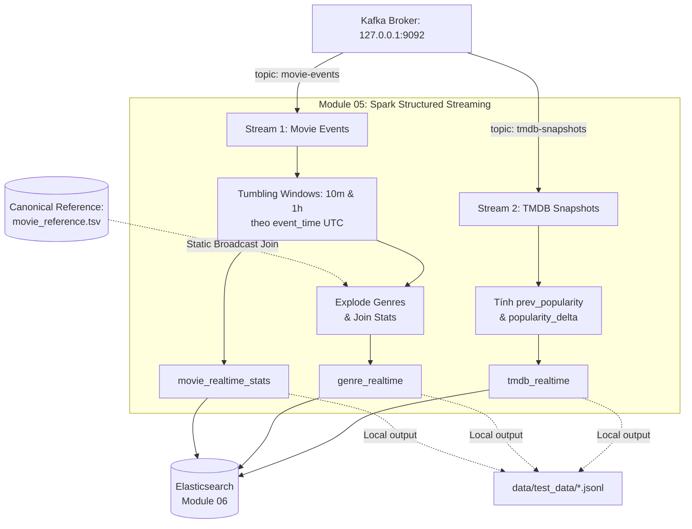

# Module 05: Spark Structured Streaming (Speed Layer)

Tầng xử lý dữ liệu thời gian thực (**Speed Layer**) sử dụng **Spark Structured Streaming** trong kiến trúc **Lambda Architecture** của dự án phân tích xu hướng tương tác phim (Movie-Trend).

- **Phụ trách (Owner):** Thắng (Module 05)
- **Vị trí hệ thống:** `modules/spark_streaming`
- **Môi trường mục tiêu:** 01 Ubuntu VM (8 GB RAM), hỗ trợ chạy trực tiếp trên Local / WSL2 hoặc triển khai lên **Kubernetes (k3s)** (namespace `bigdata`).
- **Hợp đồng dữ liệu:** Tuân thủ 100% [DATA_CONTRACT.md](../../DATA_CONTRACT.md) (Mục 5, 8, 11, 12, 16, 17, 21.4).

---

## 1. Kiến trúc & Vai trò trong Lambda Architecture

Module 05 chịu trách nhiệm tính toán các chỉ số thống kê tức thời (real-time views) với độ trễ thấp (micro-batch 15s - 30s) từ hai luồng sự kiện Kafka trước khi Batch Layer (Module 04 MapReduce) hoàn tất chu kỳ tính toán theo lô:



### Các nguyên tắc nghiệp vụ cốt lõi:
1. **Window dựa trên `event_time` UTC:** Tuyệt đối không dùng thời gian máy chủ (`ingest_time` hay hệ thống). Cửa sổ thời gian được chốt theo 2 mốc MVP: **10 phút (`10m`)** và **1 giờ (`1h`)**.
2. **Static Broadcast LEFT JOIN với Canonical Reference:** Tách chuỗi `genres` (phân tách bởi dấu `|`) thành từng dòng độc lập, đồng thời ghi nhận và giám sát `join_miss_count` (số event không khớp `movieId`).
3. **Tracking TMDB Popularity Delta:** Duy trì trạng thái snapshot mới nhất của từng `tmdbId` qua các micro-batch, tự động tính độ biến thiên `popularity_delta = popularity - prev_popularity`.
4. **Idempotent Document ID:** Sinh Document ID định danh duy nhất (`movieId|window_start|window_size`, `genre|window_start|window_size`, `tmdbId`) để đảm bảo tính bất biến (idempotent) khi upsert vào Elasticsearch hoặc ghi file.

---

## 2. Cấu trúc thư mục Module

```text
modules/spark_streaming/
├── src/
│   ├── __init__.py
│   ├── transforms.py       # Logic lõi: parse, validate, tính window 10m/1h, join reference, delta TMDB
│   ├── es_sink.py          # Sink kết quả ra Elasticsearch _bulk API và file JSONL
│   └── streaming_job.py    # Entrypoint điều phối (hỗ trợ cả mode sample và mode kafka)
├── tests/
│   ├── __init__.py
│   └── test_spark_streaming.py  # 4 bộ kiểm thử unit & acceptance tests (pytest)
├── k8s/
│   └── 01-spark-streaming.yaml  # Manifest triển khai Deployment lên cụm k3s (namespace bigdata)
├── config.yaml             # Cấu hình tài nguyên (driver 768m, partitions 4), Kafka, HDFS & ES
├── Makefile                # Bộ điều khiển tiện lợi một chạm (setup, test, run-sample, run-kafka, clean)
├── requirements.txt        # Thư viện phụ thuộc: pyspark==3.5.1, pyyaml, pytest, jsonschema
└── README.md               # Tài liệu hướng dẫn sử dụng và kiểm thử
```

---

## 3. Chuẩn bị môi trường

Từ thư mục gốc dự án (`movie-trend/`), cài đặt các thư viện cần thiết vào virtualenv:

```bash
# Cài đặt thư viện phụ thuộc
make -C modules/spark_streaming setup
```
*(Makefile tự động nhận diện Python trong `.venv` tại `movie-trend/.venv` hoặc `bigdata_prj/.venv`).*

---

## 4. Hướng dẫn chạy thử nghiệm với dữ liệu mẫu (Sample Mode)

Chế độ **Sample Mode** cho phép bạn chạy kiểm thử toàn diện toàn bộ pipeline xử lý của Spark Structured Streaming ngay trên máy cục bộ bằng dữ liệu mẫu thật mà không cần khởi động Kafka, HDFS hay Kubernetes.

### Bước 4.1: Chạy toàn bộ Unit & Acceptance Tests (Pytest)
```bash
make -C modules/spark_streaming test
```
*Kết quả:* Chạy 4 test case kiểm tra chặt chẽ:
- Parse & schema validation cho `movie-events` (cách ly bản ghi hỏng).
- Tính toán window 10m & 1h cho `movie_realtime_stats`.
- Broadcast join với `movie_reference.tsv`, explode genre và kiểm tra `join_miss_count`.
- Tính toán `popularity_delta` cho `tmdb-snapshots`.

### Bước 4.2: Chạy trực tiếp Pipeline trên tập dữ liệu mẫu
```bash
make -C modules/spark_streaming run-sample
```
Lệnh này sẽ:
1. Đọc 3 file dữ liệu mẫu từ `data/test_data/`:
   - `movie-events.sample.jsonl` (20 sự kiện tương tác thật).
   - `movie-reference.sample.tsv` (20 phim tham chiếu chuẩn).
   - `tmdb-snapshots.sample.jsonl` (20 snapshot trending TMDB).
2. Xử lý toàn diện: parse, dedup, tính cửa sổ 10m/1h, static join reference, tính delta popularity TMDB.
3. Xuất kết quả chuẩn hóa ra thư mục `data/test_data/`.

---

## 5. Kiểm tra kết quả đầu ra

Sau khi chạy `make run-sample`, kiểm tra 3 file kết quả được sinh ra trong `data/test_data/`:

```bash
# 1. Thống kê tương tác phim theo cửa sổ 10m và 1h (40 dòng = 20 phim x 2 cửa sổ)
head -n 5 data/test_data/movie_realtime_stats.jsonl

# 2. Thống kê theo thể loại sau khi nổ nhỏ từ reference (32 dòng = 16 genres x 2 cửa sổ)
head -n 5 data/test_data/genre_realtime.jsonl

# 3. Thống kê TMDB kèm biến thiên độ phổ biến (20 dòng)
head -n 5 data/test_data/tmdb_realtime.jsonl
```

### Dọn dẹp sau khi kiểm thử:
```bash
make -C modules/spark_streaming clean
```
> **Lưu ý:** Lệnh `clean` chỉ dọn sạch các file kết quả và thư mục checkpoint tạm, **bảo toàn nguyên vẹn** 3 file input mẫu trong `data/test_data/`.

---

## 6. Chạy với Kafka Ingestion thật (Liên thông Module 02 -> Module 05)

Khi muốn chạy kiểm thử liên thông dữ liệu luồng thực tế:

```bash
# 1. Khởi động Kafka Broker cục bộ (Module 02)
make -C modules/kafka_ingestion start

# 2. Tạo topics nếu chưa có
make -C modules/kafka_ingestion topics

# 3. Phát luồng sự kiện mẫu vào Kafka
make -C modules/kafka_ingestion replay RATE=100 BATCH_SIZE=50 LIMIT=500

# 4. Khởi động Spark Structured Streaming lắng nghe Kafka
make -C modules/spark_streaming run-kafka
```

Spark sẽ bắt đầu lắng nghe hai topics `movie-events` và `tmdb-snapshots`, xử lý từng micro-batch (15s/30s) và liên tục cập nhật kết quả vào `data/test_data/` cũng như upsert vào Elasticsearch (nếu có).

---

## 7. Triển khai lên Kubernetes (k3s)

Khi hạ tầng k3s đã sẵn sàng:

```bash
# Triển khai Pod Spark Streaming lên namespace bigdata
make -C modules/spark_streaming up

# Xem trạng thái Pod
make -C modules/spark_streaming status

# Xem log xử lý trực tiếp
make -C modules/spark_streaming logs

# Gỡ bỏ Deployment
make -C modules/spark_streaming down
```

---

## 8. Xử lý sự cố thường gặp (Troubleshooting)

| Dấu hiệu | Nguyên nhân | Cách khắc phục |
| :--- | :--- | :--- |
| `WARN Utils: Your hostname resolves to a loopback address` | WSL2 gán hostname về IP loopback | `Makefile` đã tự động thêm `SPARK_LOCAL_IP=127.0.0.1`. |
| `Cannot connect to Elasticsearch at localhost:9200` | Module 06 (Elasticsearch) chưa khởi chạy | Đây là cảnh báo kết nối thông thường; pipeline vẫn ghi file kết quả bình thường ra `data/test_data/`. |
| `pyspark / java not found` | Chưa cài đặt Java 8/11/17 trên môi trường WSL | Cài đặt OpenJDK: `sudo apt update && sudo apt install -y openjdk-11-jdk`. |
| `Checkpoint directory conflict` | Cấu hình offset Kafka bị lệch khi phát lại dữ liệu | Chạy `make -C modules/spark_streaming clean` để xóa thư mục checkpoint tạm và chạy lại. |
